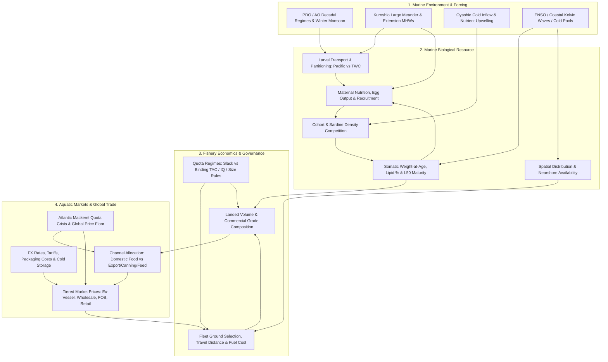

# Pacific Rim Chub Mackerel (*Scomber japonicus*): Price Dynamics, Interannual Biometric Variations, and Bio-Economic Linkages to the Marine Environment

## Executive Summary

Between 2021 and 2026, the price of chub mackerel (*Scomber japonicus* — マサバ in Japan, 고등어 in South Korea, 鲐鱼 / 白腹鯖 in Chinese-speaking markets, and *caballa* / *macarela* in Spanish-speaking Latin America) roughly doubled to tripled across major Pacific Rim markets. However, the evidence does not support an unmediated, linear "direct correlation" in which ocean warming uniformly shrinks fish and raises market prices. Instead, the literature and official statistics establish a **four-link mediated causal chain** operating across distinct temporal lags (0 to 3 years): 

$$\text{Oceanographic State} \xrightarrow{\text{0–2 yr lag}} \text{Recruitment \& Growth/Condition} \xrightarrow{\text{0–2 yr lag}} \text{Landed Tonnage \& Size Composition} \xrightarrow{\text{Same year}} \text{Tiered Market Prices}$$

While each individual link is empirically quantified, the end-to-end environmental signal is heavily attenuated—and occasionally inverted—by non-biological drivers. Specifically,Pacific Rim prices clear against a global supply floor governed by Northeast Atlantic mackerel (*Scomber scombrus*) quota policy, currency depreciation (JPY, KRW), input inflation (packaging and fuel), tariff arbitrage, and fleet spatial restructuring. 

### Headline Market and Biometric Findings

* **Global & Atlantic Price Governor:** Because Japan imports over half its mackerel consumption and South Korea relies on Norway for 70–80% of its frozen processing raw material, Norwegian Atlantic mackerel sets the marginal reference price across the Pacific Rim. Driven by warming-induced northward stock displacement into Icelandic, Faroese, and Greenlandic waters, a 15-year quota dispute (~39% chronic overcatch above scientific advice), and a 44–52% quota cut in 2026, Norwegian export prices for whole frozen mackerel (<600 g) surged 3.35-fold from NOK 15.24/kg (2021) to NOK 51.06/kg (2026), generating a record NOK 8.5 billion in 2025 export value despite a 34% volume drop.
* **Japan:** A genuine collapse of the Northwest Pacific stock—where spawning-stock biomass (SSB) fell to 97,000–144,000 t in 2023–2024 (14–16% of its 2018 peak) and Japan-only Pacific catches dropped from ~370,000 t (FY2020) to 48,000–80,000 t (FY2024)—pushed average landed prices up 60% year-on-year (YoY) to US$1.96/kg (Dec 2025), Toyosu wholesale frozen saba to ¥1,430/kg (+36% YoY, Aug 2026), and retail fillets from ¥200–300 to ¥480–600. Econometric decomposition by Japan's Ministry of Agriculture, Forestry and Fisheries (MAFF) proves producer prices track YoY *changes* in monthly landings ($r = -0.544$) and plastic foam packaging costs (+2.08% price lift per index point) rather than absolute stock biomass ($r = -0.257$).
* **South Korea:** Domestic salted retail prices rose 94% from 3,625 KRW/fish (2022) to 7,030 KRW/fish (2025), even as total national production *rose* 66% from 125,135 t (2024) to 208,259 t (2025). This "effective-supply paradox" is resolved by catch size composition and trade diversion: fish ≥300 g became scarce, while Grade 4 small fish (mean 27.6 cm, 251 g) rose from 77% to 97% of landed weight at the Busan Cooperative Fish Market ($p = 0.003$). Rather than reflecting proven population-wide dwarfing (mean fork length moved from 28.7 to 27.9 cm, $p = 0.24$, non-significant), fleets concentrated in the nearby Southern East Sea (117 km from port vs. 402 km in 2022) to supply booming West African and Chinese export demand (+538% volume from 2014 to 2025).
* **China & Russia:** China is the world's largest harvester (405,541 t in 2024; 460,238 t in 2020), anchoring the global commodity floor with bulk domestic fresh *S. japonicus* at 6 RMB/kg (≈US$0.85/kg, Zhoushan wholesale, Sep 2024), while importing 83,423 t of frozen raw material at US$2.93/kg (+30.1% YoY in 2025) for duty-free re-processing. Russia has emerged as a major demand anchor, importing 70,000 t (US$160M) in 2025 and pivoted to Pacific chub mackerel (Russian domestic catch up 6.5-fold YoY by Aug 2026; Chinese imports +57%) as domestic Atlantic mackerel wholesale prices spiked 52.7–64% to 410–420 RUB/kg.
* **Taiwan:** Operating at the southern thermal boundary where cold-water *S. japonicus* (白腹鯖, declining from 30–40% to 10–30% of catch) meets warm-water *S. australasicus* (花腹鯖, 60–70% dominant), Taiwan demonstrates how size structure governs price in reverse. In July 2016, a cold-pool anomaly (1–2°C below normal) brought a glut of juvenile fish (≥10 fish/kg vs. the normal 5 fish/kg), crashing Nanfang'ao dockside prices by 61% (from 23 to 9 NT$/kg) within weeks. Conversely, in March 2022, a La Niña-driven Kuroshio warm intrusion blocked southward migration, dropping daily boat landings from 700–800 t to <1 t.
* **Peru, Chile, Ecuador & the United States:** In Peru, landings fell 42.4% from 99,000 t (2020–2021) to 57,000 t (2024) and 33,392 t (2025); wholesale prices rose 33.5–42.3% in 2025 (reaching 5.7–7.3 PEN/kg), while retail prices in northern Piura spiked 5-to-7-fold to 25–55 PEN/kg during 2026 coastal warming anomalies. Yet in March 2017, a coastal El Niño concentrated warm-water *caballa* nearshore, boosting Lima arrivals by 43.3% and dropping wholesale prices by 27.3% (from 2.75 to 2.00 PEN/kg) in five days. In Chile, *caballa* lacks directed fishery status, operating as unmanaged bycatch (2–5% of pelagic landings) inside the jack mackerel (*Trachurus murphyi*) industry, though exports to Russia jumped 575% in 2025. The US California Current fishery is small and quota-unconstrained (705–926 mt landed in 2020–2021 at ~$0.52/kg ex-vessel; 778 mt in 2023–2024), with transboundary stock dynamics dominated by Mexican fleets in Magdalena Bay.

---

## 1. Taxonomic, Stock, and Methodological Foundations

### 1.1 Taxonomic Boundaries and Statistical Conflation
Accurate cross-market analysis requires isolating *Scomber japonicus* from four taxonomic lookalikes that routinely contaminate customs, wholesale, and retail statistics:

1. **Blue / Spotted Mackerel (*Scomber australasicus* — ゴマサバ / *gomasaba* in Japan; 花腹鯖 in Taiwan):** Sympatric with *S. japonicus* in the Northwest Pacific, possessing a warmer thermal preference and lower lipid content (1–3% in Taiwan vs. ~5% for Japanese *S. japonicus* and >15–20% for autumn Norwegian mackerel), making it unsuitable as a processing substitute for *masaba*. Japan combines both species under a single "saba-group" (*saba-rui*, さば類) Total Allowable Catch (TAC) and retail survey category; *masaba* comprised 79.0% to 90.8% of Japan's combined catch in 2014–2016. In Chinese NPFC catches, *S. australasicus* represented 6–15.2% (avg. ~10%) through 2021 and 22.5% in 2022, though China publishes no domestic species split. In Taiwan, *S. australasicus* represents 60–70% of landings, but auctions mix both species under the single label "鯖魚". In Australia and New Zealand, *S. australasicus* is marketed as "blue mackerel," "chub mackerel," or "Pacific mackerel" (per the Australian Fisheries Management Authority, AFMA); those series are excluded from this report.
2. **Atlantic Mackerel (*Scomber scombrus*):** Biologically distinct, harvested in the Northeast Atlantic, but economically inseparable in East Asia because it supplies >50% of Japanese consumption and 70–80% of South Korea's frozen raw material. Crucially, Peru's Ministry of Production (PRODUCE) official resource sheet (*ficha*) mislabels Peruvian *caballa* as *S. scombrus*, whereas the Peruvian Marine Research Institute (IMARPE) and ministerial norms (FAOLEX) classify it as *Scomber japonicus peruanus*.
3. **Atlantic Chub Mackerel (*Scomber colias*):** A separate Atlantic species (explicitly distinguished by NOAA) that enters Pacific Rim trade primarily via Moroccan and West African shipments to Russia.
4. **Spanish Mackerel (*Scomberomorus niphonius* — 鲅鱼 / 马鲛鱼 in China) & Jack/Horse Mackerels (*Trachurus* spp. — 竹筴魚 / 真鰺 in Taiwan and Japan; *jurel* in Peru and Chile):** A different genus or family entirely. In Chinese retail and e-commerce (e.g., Yimutian, Taobao), cheap *S. japonicus* (鲐鱼, ~5–10 RMB/jin) is frequently sold under the portmanteau "鲐鲅鱼" or mislabeled as higher-value Spanish mackerel (鲅鱼, which trades at 14–18 RMB/jin or 28–46 RMB/kg wholesale). Furthermore, two indexed Chinese corporate disclosures claiming to report mackerel prices were verified upon PDF inspection to concern squid and were excluded. In Taiwan, the 90,000 t national TAC combines both *Scomber* species with horse mackerel (*Trachurus*, 鯖鰺). In tropical Southeast Asia, Indian mackerels (*Rastrelliger* spp.) are also excluded.

### 1.2 Biological Stock Structure Across the Pacific Rim
National borders do not align with biological populations. *S. japonicus* is divided into five primary management units across the Pacific Rim:

* **Northwest Pacific Stock (Pacific Stock):** Spawns around the Izu Islands and southern Honshu/Shikoku (Kanto–Tokai offshore) in spring (March–June) and migrates northeast to feed in the Kuroshio–Oyashio Transition Zone (KOTZ), Sanriku, Hokkaido, and the Kuril Islands. Harvested by Japan, Russia (in its Exclusive Economic Zone, EEZ, resumed in 2015), and China (high-seas light purse seine since 2014), and managed internationally by the North Pacific Fisheries Commission (NPFC) as a priority species since 2015.
* **Tsushima Warm Current (TWC) Stock:** Spawns in the East China Sea (ECS), around Jeju Island, the Tsushima Strait, and western Kyushu, migrating into the Yellow Sea and the Sea of Japan (East Sea). Genetic and morphometric analysis (Kunimatsu 2025, Hiroshima Univ., $n = 2,975$ fish; 213,724 purse-seine records from 1973–2021) demonstrates that the ECS and Sea of Japan components are moderately mixed while both are distinct from the Pacific Stock. Harvested by China, South Korea, and Japan. TWC fish exhibit faster initial growth rates than Pacific Stock fish.
* **Taiwanese Margin Complex:** Positioned at the southern thermal boundary of the ECS, harvested primarily out of Nanfang'ao/Su'ao (Yilan County, ~80% of landings and 95% of sales) using three-boat torch-light purse-seine trios (扒網 "三腳虎" — light boat, net boat, mother carrier). Lacks an independent international analytical stock assessment.
* **Northeastern Pacific (California Current) Stock:** The primary assessed unit extends north of Punta Abreojos (Baja California, Mexico) through California, Oregon, and Washington, managed by the US Pacific Fishery Management Council (PFMC) and harvested jointly by US and Mexican fleets (especially in Magdalena Bay and Ensenada). Separate unassessed or locally assessed spawning aggregations exist around Cabo San Lucas and within the Gulf of California (where Nevárez-Martínez 2026 identifies three substocks declining in biomass but exploited within sustainability targets).
* **Southeastern Pacific (Humboldt Current) Stock (*S. japonicus peruanus*):** Ranges from Manta (Ecuador) to Valparaíso and central-southern Chile. Assessed and managed primarily by IMARPE in Peru and monitored by the Instituto de Fomento Pesquero (IFOP) in Chile and the Instituto Público de Investigación de Acuacultura y Pesca (IPIAP) in Ecuador.

### 1.3 Biometric and Economic Measurement Frameworks
To prevent analytical errors when synthesizing fisheries and market data, four methodological distinctions govern this report:

#### Length Metrics and Allometry
Studies report fork length ($\text{FL}$, tip of snout to tail fork), total length ($\text{TL}$, to tail tip), or standard length ($\text{SL}$, to caudal-fin base); these are not interchangeable. In Kunimatsu's (2025) NW Pacific measurements ($n = 2,975$), commercial size grades map to age across a 7–8 year lifespan: "very small" averages $278.5\text{ mm FL}$ (age 1), "small" $305.4\text{ mm}$ (age 2), "medium" $339.6\text{ mm}$ (age 3), and "large" $375.3\text{ mm}$ (age 4+). Individual weight relates to length allometrically via $W = aL^b$. Because $E[L^b] \neq (\bar{L})^b$ (Jensen's inequality), mean weight cannot be accurately computed by plugging mean length into a length-weight equation. As a theoretical illustration, if shape is isometric ($b = 3$) and condition is constant, a 10% reduction in length yields a $27.1\%$ reduction in body weight ($1 - 0.9^3 = 0.271$). Relative condition factor ($K_n = W / W_{\text{expected}}(L)$, calculated after excluding stomach and gonad mass) avoids the size bias of Fulton's $K \propto W/L^3$ when $b \neq 3$.

#### Four Distinct Biometric Indicators
1. *Mean landed length/weight:* Reflects what reaches the dock; heavily confounded by gear selectivity, fishing ground choice, and recruitment pulses. For a grade $g$ with landed biomass $B_g$ and mean individual mass $\bar{W}_g$, fish count is $N_g = B_g / \bar{W}_g$; number-weighted mean length differs from biomass-weighted share.
2. *Length/weight-at-age:* Measures true somatic growth of cohorts (requires otolith age reading rather than length-frequency mode fitting).
3. *Weight at fixed length ($K_n$) and Lipid Content:* Measures physiological fatness. Yatsu et al. (2019, $n = 2,085$ fish, $21–42\text{ cm FL}$, 2012–2017) showed via generalized additive models (GAMs) that while fat and $K_n$ are high in September–January, their relationship is nonlinear with strong independent year effects (positive fat effects in 2016–2017). Condition indices do not automatically equal lipid percentage or edible fillet yield.
4. *Maturation thresholds:* $L_{50}$ (or $Lm_{50}$) is the length at which 50% of individuals are mature; *first-maturity length* (used in Taiwanese NTOU studies) is the smaller threshold at which maturation begins.

#### Price Decomposition (Within-Grade Repricing vs. Composition Shift)
Where transaction prices for a specific grade and product form are unavailable, aggregate value divided by aggregate volume yields a **unit value**:

$$U_t = \frac{\sum_g P_{g,t} Q_{g,t}}{\sum_g Q_{g,t}} = \sum_g s_{g,t} P_{g,t}$$

Changes in unit value between period $0$ and period $1$ decompose into three terms:

$$U_1 - U_0 = \underbrace{\sum_g s_{g,0}(P_{g,1} - P_{g,0})}_{\text{Within-grade repricing}} + \underbrace{\sum_g P_{g,0}(s_{g,1} - s_{g,0})}_{\text{Grade composition shift}} + \underbrace{\sum_g (s_{g,1} - s_{g,0})(P_{g,1} - P_{g,0})}_{\text{Interaction term}}$$

As an illustrative valuation, if large and small grades sell for $4$ and $1$ currency units/kg respectively, and the large-grade share falls from 20% to 10% with prices unchanged, the average unit value drops by $18.75\%$ (from $1.6$ to $1.3$). Conversely, general price inflation during a supply shortage can raise $U_t$ even as biological quality ($s_g$) deteriorates.

#### Stock vs. Flow and Supply-Chain Stage
Spawning biomass ($SSB_t = \sum_a N_{a,t} W_{a,t} m_{a,t}$, where $m_{a,t}$ is maturity fraction) is an accumulated biological stock; daily market arrivals and exports are flows; cold-storage holdings are inventories. Ex-vessel (landed) prices, wholesale auction prices, free-on-board (FOB) or cost-and-freight (CFR) trade unit values, and retail prices per fish or fillet pack incorporate different processing yields, transport costs, and margins, and cannot be directly equated across countries.

---

## 2. Global Trade Architecture and Pacific Rim Market Price Dynamics

### 2.1 Cross-Market Price Synthesis
Table 1 compiles verified price observations across all surveyed markets, preserving exact market stages, product forms, currencies, and effective dates.

| Country / Market | Statistical Object & Product Tier | Observed Price / Value | Effective Date / Window | Change / Context | Primary Source / Evidence Grade |
| :--- | :--- | :--- | :--- | :--- | :--- |
| **Norway (Global Benchmark)** | Export whole frozen Atlantic mackerel (<600 g) | NOK 10 $\rightarrow$ 20 $\rightarrow$ 50+/kg (NOK 15.24 $\rightarrow$ 51.06/kg) | 2004 $\rightarrow$ 2023 $\rightarrow$ 2025 (2021 $\rightarrow$ 2026 series) | 3.35× rise (2021–26); broke NOK 30, 40, 50 in 2025 alone | Norwegian Seafood Council (NSC) via trade media; 上下游 (2026-09) |
| **Japan** | National average landed price (Pacific mackerel) | US$1.96/kg | 2025-12 | +60% YoY; 4-year high | Fish Union Analytical Center |
| **Japan** | Monitored landing ports wholesale ("mackerels" category) | 99 $\rightarrow$ 117 $\rightarrow$ 136 $\rightarrow$ 137 JPY/kg | 2014 $\rightarrow$ 2022 $\rightarrow$ 2023 $\rightarrow$ 2024 | +37.7% (2014–24); +0.4% (2023–24) on unrounded data | JFA Statistical Table 2-10 (Official; port sample shifted 210 $\rightarrow$ 147 $\rightarrow$ 48) |
| **Japan** | Producing-port average (117 ports, fresh saba) | 935 / 831 / 751 JPY/kg | Jan / Feb / Mar 2024 | Seasonal post-winter progression | JAFIC survey (Official-derived) |
| **Japan** | Osaka Prefectural Central Wholesale Market | Fresh: 375 JPY/kg; Frozen: 899 JPY/kg; Salted: 753 JPY/kg | 2024-06 | Indices vs Jun 2023: Fresh 100, Frozen 129 (44,111 kg fresh sold) | Osaka Market Operator Table (Official) |
| **Japan** | Toyosu Market wholesale (frozen vs. salted vs. fresh) | Frozen: 1,430 JPY/kg; Salted: 1,313 JPY/kg; Fresh median: 605 JPY/kg | 2026-08 (Frozen/Salted); 2026-10-23 (Fresh, 21 mkts) | Frozen: +36% YoY (+9% MoM); Salted: +74% YoY (+17% MoM) | Tokyo Metro Wholesale Market via jp.gdfreak; sakana-souba-navi |
| **Japan** | Norwegian frozen import price / raw material | ~200 $\rightarrow$ ~600 JPY/kg (2025); 885 JPY/kg (May 2026) | 2010–20 $\rightarrow$ 2025 $\rightarrow$ 2026-05 | 3× vs 2010s; May 2026 is 1.5× YoY and >3× vs 5 yrs prior | MoF Trade Stats via Mainichi; Toyo Keizai (Katano) |
| **Japan** | Retail fillets & Kyushu live-bait small saba | Fillets: 200–300 $\rightarrow$ 480–600 JPY; Live bait: 130–140 JPY/fish | 2021 $\rightarrow$ 2025/2026 | Fillets doubled; restaurant saba lunch ¥1,000 $\rightarrow$ ¥1,280 | Toyo Keizai; Mainichi; TBS; FNN; Minato-Yamaguchi |
| **South Korea** | Busan Cooperative Fish Market (BCFM) auction by grade | G1: 9,752 $\rightarrow$ 13,327 KRW/kg; G2: 6,503; G3: 3,576; G4: 1,355 | 2024 levels $\rightarrow$ 2025 (G1) | 7.2× G1/G4 spread; 2025 G1 +37% YoY, G4 +50% nom. (+55.6% real) | Yoo & Yoon (2026) (Peer-reviewed; BCFM/NIFS data) |
| **South Korea** | Busan overall auction avg. & Noryangjin wholesale | Busan: 2,495 KRW/kg (10,880 t); Noryangjin: 4,334 KRW/kg | Jan 2026 (Busan); H1 2026 (Noryangjin) | Noryangjin +21% YoY; ex-vessel 1,817 $\rightarrow$ auction 1,900 KRW (kati) | Korea Stripes; Chosun Ilbo |
| **South Korea** | National monthly distribution stack (Observatory #332) | Producer: 4,024 $\rightarrow$ 2,874 KRW/kg; Fresh whsl/ret: 6,093 / 11,211; Frozen whsl/ret: 5,547 / 12,083 | 2023-09 | Producer −28.6% MoM on ≥300g influx; Fresh whsl +32.4% YoY; Frozen ret +45.8% vs 5-yr norm | KMI / Statistics Korea / aT KAMIS (Official) |
| **South Korea** | Domestic salted retail & Refrigerated retail (per fish) | Salted: 3,625 $\rightarrow$ 7,030 $\rightarrow$ 7,158 KRW/fish; Refrig: 3,534 $\rightarrow$ 4,640 $\rightarrow$ 4,018 $\rightarrow$ 4,739 KRW/fish | Salted: 2022 $\rightarrow$ 2025 $\rightarrow$ Jan–Feb 2026; Refrig: 2021 $\rightarrow$ 23 $\rightarrow$ 24 $\rightarrow$ 25 | Salted +94% (2022–25); Refrig +34.1% (2021–25), Jan–Apr 2026: 4,545 (−4.2% YoY) | aT KAMIS via Asia Economy & KMI presentation (Official-derived) |
| **South Korea** | Frozen retail (≥400g), Norwegian salted retail, Import unit | Frozen ≥400g: 4,689 KRW/kg; Norw. salted: 10,960 KRW; Import: US$3.3/kg | 2025 avg (Frozen); 2026-07 (Norw.); 2025-11 (Import) | Frozen +16.9% YoY; Norw. salted +27.2% YoY; Import +27% YoY; CPI +10.3% (2025) | aT; Korea JoongAng Daily; Korea Customs; KOSTAT |
| **China** | Zhoushan International Aquatic Products City wholesale | Domestic fresh bulk 鲐鱼: 6 RMB/kg (≈US$0.85/kg) | 2024-09-03 | Listed separately from 马鲛鱼 (14–28 RMB/kg); size unstated | Zhejiang Processors Assoc. bulletin (Official market feed) |
| **China** | Frozen mackerel imports (customs border tier) | US$2.25/kg (2024, US$161M) $\rightarrow$ US$2.93/kg (2025, US$245M on 83,423 t) | 2024 $\rightarrow$ 2025 trade years | Price +30.1% YoY, Vol +16.5%, Val +51.6% (GTAIC gives +54.7% on 2024 base) | China Customs via canyin88; GTAIC |
| **China** | Export FOB unit values & B2B / Domestic snippets | Exports to VN: US$1.02/kg (2023); Global: US$0.60–1.00/kg (2024); Tridge frozen: US$2.42–2.60/kg | 2023–2025 | Domestic e-commerce "鲐鲅鱼" 9.5 RMB/jin (species-conflated); Weihai mkt omits 鲐鱼 | JETRO / GTA; Tridge; MARA Weihai table |
| **Taiwan** | Su'ao wholesale market (mixed 鯖魚 category) | 38.7 NT$/kg (1,515,550 kg) & 38.2 NT$/kg (1,605,490 kg) | 2026-09-30 to 10-13 & 2026-10-02 to 10-15 | ~178 t/day traded; domestic 花腹鯖 whsl <50% of Norwegian price | Ministry of Agriculture (MOA) Transaction Database (Official) |
| **Taiwan** | Nanfang'ao dockside purchase price (2016 crash) | 23 NT$/kg (2015) $\rightarrow$ 18 NT$/kg $\rightarrow$ 9 NT$/kg | 2016-07 | −60.9% within weeks due to ≥10 fish/kg juvenile glut | 上下游 News Market (Verified reporting) |
| **Taiwan** | Frozen Norwegian import cost & Local premium retail | Duty-paid whole: 240 NT$/kg (processed 450–500); Local sashimi/spotted: 150–200 NT$/kg (or 200 NT$/jin) | Early 2026 (Import); Jul–Sep 2026 (Retail) | Import cost doubled; modeled Norw. floor 510 vs ceiling 240–260 NT$/kg | 湧升海洋 analysis (2026-03); Newsmarket; Instagram snippets |
| **Russia** | Wholesale Atlantic mackerel & Import/Export values | NW Russia: 410 RUB/kg (+64% YoY); Central: 420 RUB/kg (+52.7% YoY); Imports: US$160M / 70,000 t | 2026-08-31 (Wholesale); 2025 (Imports) | Import unit ~US$2.29/kg (+14% value); Export range US$2.30–3.90/kg | Natsrybresurs via Kommersant; Fish Union; Tridge |
| **Peru** | Wholesale markets (National avg, Lima/Callao, Regional) | Nat avg: 4.1 PEN/kg (≈US$1.1); Lima: 4.3 $\rightarrow$ 5.7 PEN/kg (+33.5%); Regional: 5.2 $\rightarrow$ 7.3 PEN/kg (+42.3%) | Jan–May 2025 (4.1); 2024 $\rightarrow$ 2025 annual (Lima/Reg); Mar 2017 event: 2.75 $\rightarrow$ 2.00 PEN/kg (−27.3%) | Mar 2017 price drop occurred during Coastal El Niño (+43.3% arrivals) | PRODUCE Ficha (May 2025), Sectoral Report (Feb 2026), & Mar 2017 Notice (Official) |
| **Peru** | Northern retail (Piura) & Lima retail fillets; Export FOB | Piura whole: 4–8 $\rightarrow$ 24–30 PEN/kg (up to 55); Fillets: 40–55 PEN/kg; Export FOB: US$0.983 $\rightarrow$ 0.969/kg | May–Oct 2026 (Retail); 2023 $\rightarrow$ 2024 (Export FOB) | Retail 5–7× spike on scarcity; Export FOB −1.5% on 35% volume drop | Walac; Norte Sostenible; HTV; PROMPERÚ (Official trade) |
| **United States** | West Coast ex-vessel implied unit value (PacFIN / SAFE) | US$240/mt (2012) $\rightarrow$ US$523/mt (2021, real 2021$); US$0.24/lb (≈US$0.53/kg) | 2012–2021 series; FY2023–24 ($406,702 / 778 mt); 2024 ($0.8M / 3.3M lb) | Ex-vessel value doubled as volume fell from 6,126 mt to 705–926 mt | PFMC SAFE Appendix A; 90 FR 41376 (Aug 2025); NOAA (Official) |
| **Chile** | Unverified aggregator & export unit value | Domestic aggregator: US$4.05/kg; Export unit: ~US$3.67/kg ($3.7M / 1,008 t) | Jan 2025 (Aggregator); 2024 (Exports) | No official species-specific price series; priced inside *jurel* economics | IFOP (2024); Selinawamucii (Unverified aggregator) |

### 2.2 The Global Reference Layer: The Northeast Atlantic Quota Crisis and Trade Redirection
Although harvested in a different ocean, Northeast Atlantic mackerel (*S. scombrus*) is the marginal price governor for Pacific Rim *S. japonicus* because it anchors the high-fat frozen processing and retail fillet tier in Japan, South Korea, Taiwan, and China. 

Between 2021 and 2026, this top tier experienced a structural supply collapse driven by five sequential mechanisms:
1. *Climate-driven spatial shift:* Ocean warming pushed Atlantic mackerel northward and westward out of traditional Norwegian and EU waters into the EEZs of Iceland, the Faroe Islands, and Greenland (mirroring FAO SOFIA 2026 projections that ~23% of transboundary stocks will shift geographically by 2030).
2. *Institutional breakdown:* As new coastal states demanded quota shares and historical holders refused, unilateral quota setting drove actual catches ~39% above International Council for the Exploration of the Sea (ICES) scientific advice on average for 15 years, depleting spawning biomass. Russia similarly set a unilateral 2026 quota of 67.5 kt (22.5% of the world total vs. its negotiated 20.6% share), triggering European port bans on Russian vessels for bunkering and transshipment.
3. *The 2025–2026 Quota Cuts:* For 2025, ICES recommended a 22% TAC cut to 577,000 t; for 2026, ICES advised a 77% cut to 174,357 t (~170,000 t). The coastal states (UK 30.6%, Norway 26.4%, Faroes 12.0%, Iceland 10.5%, EU+Greenland+Russia 20.6%) negotiated a combined 2026 quota of 299,010 t—still 48% below 2025 and far above scientific advice. Norway's national quota was cut from 215,000 t (2024) to 152,000–165,298 t (2025, preliminary vs. final accounting across secondary reports) and down to 78,939–85,500 t in 2026 (a 44–52% single-year reduction).
4. *Harvesting and Macro Cost Escalation:* Declining catch-per-unit-effort (CPUE) spread fixed vessel costs over smaller volumes (adding an estimated NT$24–32/kg to harvesting cost), compounded by crude oil rising from US$70 to US$90/bbl in 2026 amid Middle East conflict.
5. *Inelastic Asian Demand and Three-Tier Trade Redirection:* Norway shipped 196,030–208,000 t of whole frozen mackerel in 2025 (−34% by volume) for a record NOK 8.5 billion. Export prices for <600 g fish—which took 19 years to double from NOK 10/kg (2004) to NOK 20/kg (2023)—broke NOK 30, 40, and 50/kg within 2025 alone, reaching NOK 51.06/kg in 2026.

This Atlantic shock reorganized Pacific Rim trade along a three-tier quality-price ladder (documented by JETRO's 2025 Global Trade Atlas analysis):
* **Tier 1 (High-Fat Processing & Retail):** Norwegian Atlantic mackerel (landed in Vietnam at US$2.80/kg in 2023 on 38,471 t / US$107.76M, rising to >US$5.00/kg globally by 2026) and Japanese autumn-fat *masaba* ("aki-saba" / "toki-saba" ≥400 g with 20–30% lipid).
* **Tier 2 (Mid-Tier Re-processing & Canning):** Small Korean and Japanese frozen *S. japonicus*. Because Japan levies a 7% tariff on whole Norwegian fish and 10% on fillets while imports processed in Vietnam or China enter duty-free under regional trade agreements, Vietnam and China act as zero-tariff re-processing hubs for Japan-bound fillets. As Norwegian prices spiked, Thailand's Norwegian mackerel imports fell 42% (Jan–May 2025 to 2026), substituting toward Japanese, Taiwanese, and Chinese chub mackerel (China holds a 35.8% import share in Thailand). European canneries also began purchasing Korean small-grade *S. japonicus*.
* **Tier 3 (Commodity Direct Consumption):** Chinese frozen mackerel exports (US$0.60–1.00/kg globally in 2024; US$1.02/kg into Vietnam in 2023 on 21,338 t / US$21.77M) and small Japanese/Korean/Peruvian shipments to West Africa (Ghana, Côte d'Ivoire, Nigeria) and Egypt.

### 2.3 Country-by-Country Market Dynamics

#### Japan: Resource Collapse, Cost-Push Elasticity, and the "Quota Illusion"
In 1990, domestic Japanese *saba* commanded a higher price than Norwegian imports; today the hierarchy is inverted because Norway harvests strictly during the autumn high-fat season ("saba nouveau" is even air-freighted fresh to Japan for sushi), whereas Japanese landings became progressively smaller and leaner (“candle fish”). 

Japan is the only Pacific Rim market with an official econometric decomposition of mackerel price formation. Analyzing 2010–2024 monthly data, MAFF (Sep 2025) demonstrated that producer-market prices for the *saba* group correlate weakly with the *absolute level* of landings ($r = -0.257$) but strongly with the *year-over-year same-month change* in landings ($r = -0.544$), strengthening to $r = -0.631$ to $-0.644$ when grouped with substitute small pelagics (sardines plus two horse-mackerel species). Wholesalers holding frozen inventory price current landings against their acquisition cost in the same month of the prior year. Controlling for consumer inflation, MAFF quantified statistically significant input-cost elasticities on producer prices: plastic foam packaging (+2.08% per index point), electricity/gas/water (+0.40%), A-heavy fuel oil (+0.28%), and naphtha (+0.12%). This explains why Japanese producer prices began rising in 2015 during a high-catch plateau (301–332 kt/yr in 2015–2018): packaging and distribution labor/fuel margins drove the 2015–2019 climb, whereas biological scarcity took over after 2020.

Between 2018 and 2024, Japan's domestic *saba-rui* catch (both species, all stocks) fell by more than half from 540,000 t (2018) to 269,636 t (2023) and 256,000 t (2024). On the Pacific Stock specifically, Japan-only catches collapsed from 301,000–332,000 t (2015–2018) and ~370,000 t (FY2020) to 187,000 t (2021), 98,000 t (2022), 73,000 t (2023), and 48,000–80,000 t (2024, depending on calendar vs. fishing-year accounting). Critically, domestic quota policy was never the binding constraint: in FY2023–2024 (July–June), the Pacific *saba* TAC was set at 510,000 t, but fleets caught only ~110,000 t (~20% utilization). Domestic scarcity was purely biological, exacerbated by the diversion of small domestic *saba* into aquaculture feed (Katano, *Toyo Keizai*).

Compounded by the yen depreciating to ~160/USD and the Norwegian quota cut, Japanese frozen Norwegian import prices reached 885 JPY/kg in May 2026 (matching the 935 JPY/kg fresh domestic port price of Jan 2024). Toyosu wholesale frozen *saba* hit 1,430 JPY/kg and salted *saba* 1,313 JPY/kg (+74% YoY) in August 2026. Downstream impacts were severe: Japanese *saba* exports fell 57.4% from 176,729 t (2021) to 75,241 t (2023) and ¥9.8 billion in 2024 (−19.5%); domestic canned *saba* production fell by half in one series (to 21,000 t in 2024, Japan Canners Assoc.) and by 3.1% to 71,488 t in 2025 in another (Minato); seafood processor bankruptcies rose to 46 in 2025 and 29 through July 2026 (~50 projected for full-year 2026, Teikoku Databank); and in early 2026, Japanese direct imports of Norwegian herring exceeded mackerel for the first time in history. To capture higher margins, Japanese operators have expanded live-holding and short-term fattening (*chikuyo*, 蓄養), selling branded cultured/live-killed *saba* at 3–5× bulk wholesale prices and sashimi fillets at up to 10× whole-fish prices.

#### South Korea: The Effective-Supply Paradox and Grade-Driven Export Diversion
South Korea illustrates how aggregate tonnage and consumer prices can move in opposite directions. While total national mackerel production jumped 66.4% from 125,135 t (2024) to 208,259 t (2025), consumer prices for domestic salted mackerel rose 94% from 3,625 KRW/fish (2022) to 4,299 (2023), 5,369 (2024), 7,030 (2025), and 7,158 KRW/fish (Jan–Feb 2026), with the Statistics Korea (KOSTAT) mackerel CPI posting double-digit YoY increases every month from April 2025 (+10.3% annual 2025; +11.7% in Jan 2026). Meanwhile, KMI/KAMIS data for *refrigerated* retail mackerel show non-monotonic interannual swings: 3,534 KRW/fish (2021) $\rightarrow$ 4,273 (2022) $\rightarrow$ 4,640 (2023) $\rightarrow$ 4,018 (2024, −13.4%) $\rightarrow$ 4,739 (2025, +17.9%), and 4,545 KRW in Jan–Apr 2026 (−4.2% vs. 4,743 KRW in Jan–Apr 2025).

This divergence is governed by a strict size-grade price schedule at the Busan Cooperative Fish Market (BCFM), which handles 98.9% of the large purse-seine fleet's chub mackerel landings (68.4% of national large-purse-seine chub production, or ~90% of total national landings depending on denominator). Under National Institute of Fisheries Science (NIFS 2024) thresholds, fish >30 cm enter domestic food retail, fish <30 cm go to export or canning, and fish <200 g go to fishmeal/aquaculture feed:

| BCFM Grade | Mean Fork Length (cm) | Mean Weight (g) | Share <30 cm FL | Share <200 g | 2024 Price (KRW/kg) | 2025 Price (KRW/kg) | Primary Market Channel |
| :--- | :---: | :---: | :---: | :---: | :---: | :---: | :--- |
| **Grade 1** | 36.8 | 694 | 1% | 1% | 9,752 | 13,327 (+36.7%) | Domestic premium food |
| **Grade 2** | 34.5 | 543 | 1% | 0% | 6,503 | — | Domestic food |
| **Grade 3** | 31.8 | 403 | 17% | 0% | 3,576 | — | Mostly domestic food |
| **Grade 4** | 27.6 | 251 | 83% | 25% | 1,355 | +50% nom. (1,743 real) | Export / canning / feed |

A 9.2 cm difference in fork length between Grade 1 and Grade 4 produces a **7.20-to-1 price ratio**. In September 2023 (Observatory #332), producer prices fell 28.6% MoM (4,024 $\rightarrow$ 2,874 KRW/kg) specifically because the share of medium/large fish (≥300 g) rose temporarily, even though the annual ≥300 g share was down to 31.0% vs. 45.8% a year earlier. Across 2014–2025, Grade 4's share of landed weight at Busan rose from 77% to 97% ($p = 0.003$), starving the domestic market of >300 g fish.

Simultaneously, an export boom absorbed the small fish. Following the 2022 disruption of Russian Atlantic mackerel and falling Japanese exports to West Africa (Ghana, Côte d'Ivoire, Nigeria), plus surging Chinese demand (Korean export value to China rose 639.4% in 2025; Autotribune Nov 2025), total Korean mackerel exports expanded from 22,600 t / US$28M (2014) to 111,117 t (2023) and 143,920–144,200 t / US$200M (2025), reaching US$181.7M in H1 2026 alone (+247% YoY). Aided by won depreciation (from 1,053 to 1,421 KRW/USD), Grade 4's share of fleet revenue climbed from 47% to 89%. While Grade 4 real prices rose 55.6% (1,120 $\rightarrow$ 1,743 KRW/kg in 2020 prices, $p = 0.03$), its relative price ratio against Grade 1 remained completely flat (0.16 $\rightarrow$ 0.15). Thus, small fish did not gain a quality premium; rather, all grades inflated together while export channels monopolized the volume.

In the domestic consumer market, structural distribution costs absorb 58.3% of the retail price (MOF 2018 survey), and short-term weather anomalies cause severe spikes (e.g., a 2.5× fresh auction price jump during a record 2019 monsoon week). With Norwegian import unit prices hitting US$3.3/kg (+27% YoY in Nov 2025) and retail Norwegian salted mackerel reaching 10,960 KRW (+27.2% YoY in Jul 2026), the South Korean government released a record 20,000 t of stockpiled seafood at up to 40% discounts before Chuseok and dispatched a "mackerel envoy" to Norway in July 2026.

#### China: The Dual-Tier Harvester and Re-Processing Gateway
China harvests more chub mackerel than any other nation (peaking at 592,637 t in 2008; 460,238 t or 34% of global output in 2020; 405,541 t in 2024), yet exhibits a bifurcated market structure. 
* *Domestic Bulk Tier:* At the Zhoushan International Aquatic Products City (China's largest aquatic wholesale market, 3 Sep 2024 bulletin), domestically landed fresh bulk *S. japonicus* (鲐鱼) traded at just **6 RMB/kg (≈US$0.85/kg)**—listed on a separate row from Spanish mackerel (马鲛鱼, 14 RMB/kg for 250–500 g and 28 RMB/kg for 500–1000 g). Conversely, northern flagship wholesale markets such as Weihai (Shandong, 24 Oct 2026 MARA table of 25 categories) omit *S. japonicus* entirely while quoting Spanish mackerel (鲅鱼) at 28.00 RMB/kg. In domestic retail, species conflation between 鲐鱼 and 鲅鱼 prevents premium price discovery.
* *International Processing & Import Tier:* China's domestic consumption of Norwegian Atlantic mackerel grew 35% between 2020 and 2024 to ~12,000 t, and China took 9% of Norway's total 2025 mackerel exports. Across all frozen mackerel imports (mostly re-processing raw material), Chinese customs recorded 71,589 t worth US$161M (US$2.25/kg) in 2024, rising to **83,423 t worth US$245M (US$2.93/kg)** in 2025 (+16.5% volume, +51.6% value, +30.1% unit price; GTAIC reports US$161.31M, +54.7% on a slightly different perimeter). Because of the 3.5× spread between border import costs (US$2.93/kg) and domestic dockside bulk (US$0.85/kg), and because Norwegian volume to China fell 31.2% in 2025 (as Norwegian prices rose 36.0%), Chinese processors aggressively diversified their supplier base: imports from Iceland rose +150.7%, the UK +161.6%, Greenland +152.8%, Ireland +81.2%, and South Korea +639.4%. On the export side, China shipped 206,257 t of mackerel in H1 2025 (+34%), with Dalian processors pivoting to Pacific chub mackerel to hedge Atlantic price uncertainty.

#### Russia: Volatile Harvester and the New Global Demand Anchor
Russia participates in the Pacific Rim system both as a high-seas/EEZ harvester and as a massive consumer market. On the harvest side, Russia resumed a specialized NW Pacific chub mackerel fishery in 2015, peaking at 98,812 t in 2018 before collapsing by 93% to 7,200 t in 2024 (VNIRO/TINRO standardized CPUE series). A broader industry perimeter reported by the Russian Fish Union (*Rybny Soyuz*) puts the 2025 Far East harvest at 8,600 t (+60% YoY, implying a ~5,400 t base in 2024 on that specific perimeter).

On the consumption side, mackerel ranks at the top of Russian consumer preferences. In 2025, Russia imported **70,000 t of frozen mackerel worth US$160 million** (+2% volume, +14% value), while retail sales across eight federal chains rose 15% in volume and 50% in value (implying an ~30–33% retail unit price increase). As Atlantic supplies tightened and sanctions inflated operating costs, Russia's 2025 import basket shifted rapidly away from the Faroe Islands (35,000 t, −25%) and South Korea (5,000 t, −9%) toward China (20,000 t, +57%), Morocco (6,000 t of Atlantic chub, +155%), and Chile (3,000 t, +575%). Momentum accelerated in 2026: Russian mackerel imports from China rose +25% in volume / +110% in value in Jan–Mar 2026 (and +5% volume / +65% value in Jan–May). By August 31, 2026, wholesale Atlantic mackerel prices in northwestern Russia hit 410 RUB/kg (+64% YoY) and 420 RUB/kg in central Russia (+52.7% YoY, Natsrybresurs), causing Russian consumer mackerel volume to contract by 28% in H1 2026. In response, the Fish Union and Rosrybolovstvo actively promoted Pacific *S. japonicus* (usable across all Russian product forms except cold-smoked mackerel) and Pacific herring (+34% catch to 498 kt) as domestic substitutes, approving higher mutual quotas with Japan and driving Russian-waters Pacific mackerel catches up 6.5-fold YoY by August 26, 2026 (reported as "26 t," an evident typographical error for 26,000 t against an implied ~4,000 t partial-year 2025 base).

#### Taiwan: The Southern-Margin Boom-Bust and the Import Ceiling Trap
Taiwan's mackerel and horse-mackerel (鯖鰺) fishery produces 70,000–80,000 t/yr (worth NT$3–5 billion, >55–60% of Taiwan's inshore/coastal fishery value), with mackerel alone averaging NT$3.12 billion/yr over 2012–2021 (and 55,297 t in 2017, though pure mackerel catch fell to a 16-year low of 42,660 t in 2021). Yilan County statistics show high interannual volatility: 14,056 t (2019) $\rightarrow$ 9,873 t (2022, 5-year low) $\rightarrow$ 21,215 t (2023, +51% rebound, 27.4% of national output). Domestic size grades mirror Korea's: single fish of 20–22 cm (>200 g) supply the domestic salted-saba and fillet trade; 17–20 cm fish go to canning or tuna longline bait; smaller fish go to Southeast Asian export or fishmeal.

In July 2016, following the June closed season, Nanfang'ao fleets landed an overwhelming glut of thumb-sized juveniles (≥10 fish/kg vs. the historical 5 fish/kg). Because the entire catch fell below the >200 g food threshold into the commodity bait/fishmeal tier, dockside purchase prices crashed **60.9% from 23 NT$/kg (2015) to 18 NT$/kg and then 9 NT$/kg** within weeks—below operating cost. Fishermen instituted a voluntary self-management rule: release fish at sea when ≥10 fish/kg and halt fishing the next day whenever the daily auction average drops below 15 NT$/kg. However, lacking legal penalties and undermined by continued fishing at neighboring Gongliao and Aodi ports (New Taipei), the rule proved weak, and biological efficacy was further capped by the ~30% survival rate of released juveniles (which suffer capture stress and scale loss in *toras* nets).

In the current market (Oct 2026), official MOA wholesale transaction records for Su'ao show mixed "鯖魚" averaging **38.2 to 38.7 NT$/kg** on ~1.52–1.61 million kg traded per two-week window (~178 t/day), while specialty single-boat hook-and-line sashimi-grade spotted mackerel commands 150–200 NT$/kg (or NT$200/jin in retail snippets). However, because domestic *S. australasicus* contains only 1–3% lipid, its wholesale price sits permanently below half that of imported Norwegian mackerel (which supplies 76% of Taiwan's 11,826 t of imports in 2017 and >80% by 2026). 

In early 2026, the landed duty-paid cost of frozen whole Norwegian mackerel in Taiwan doubled to **240 NT$/kg** (pushing processed fillet cost to 450–500 NT$/kg). An industry bio-economic model by 湧升海洋 (Mar 2026) demonstrates a structural trap: Norwegian fishers face a quota-loan amortization "survival floor" of **NT$510/kg** and a theoretical rigid-demand crash point of **NT$630/kg**, but Taiwan's consumer market imposes a **real price ceiling of NT$240–260/kg**, anchored by C&F imports of Chilean coho/silver salmon (which substitute directly for salted mackerel in Taiwanese bento and restaurant meals). Because the domestic substitute ceiling (NT$240–260) sits below Norway's cost floor (NT$510), Norwegian mackerel is retreating from Taiwan's mass market into a luxury niche. Furthermore, since 2025, Taiwanese customs data show CFR declared import prices decoupling downward from FOB export prices—indicating widespread customs under-invoicing to evade tariffs, which introduces a downward bias across Asian customs unit-value series. Meanwhile, international buyers seeking alternatives to expensive Norwegian fish have turned to cheap Taiwanese mackerel, creating export pressure on a domestic stock whose fishing mortality ($F$) in 2025 already exceeded limit reference points.

#### Peru, Chile, Ecuador, and the United States: The Eastern Pacific Rim
* **Peru:** *Caballa* is a vital staple protein for lower-income Peruvian households, representing **15.7% of all volume** entering Peru's wholesale fish markets and supporting ~5,800 artisanal fishers across ~1,300 boats (CENPAR 2012 census; in 2025, landings were 63% artisanal and 37% industrial). Legally restricted 100% to Direct Human Consumption (DHC / *CHD* under D.S. 001-2002-PRODUCE; split 42.6% frozen, 37.2% fresh, 20.2% canned in Jan–May 2025), Peruvian landings peaked at 99,000 t in 2020 and 2021, then declined steadily to 91,000 t (2022), 81,000 t (2023), 57,000 t (2024, −42.4% from peak), and 33,392 t in full-year 2025 (with Jan–May 2025 down 29.6% YoY from 39 kt to 28 kt; February 2025 alone accounted for 14,933 t or 44.7% of the annual catch). A separate PRODUCE "production" series (registering processed/channel output rather than raw landings) shows the identical trend: falling 44.0% from 46.9–47.1 kt (2020–2021) to 26.4 kt (2024). Simultaneously, Peruvian *caballa* imports (including Chinese frozen fish) crashed from 26,500 t (2021) and 25,700 t (2022) to 5,300 t (2023) and 3,300 t (2024, ~5% of supply), compounding domestic scarcity as domestic sales fell from 74,600 t (2022) to 38,300 t (2024).
  
  This supply contraction drove official wholesale prices in Lima/Callao up 33.5% from **4.3 to 5.7 PEN/kg** between 2024 and 2025, and regional wholesale baskets up 42.3% from **5.2 to 7.3 PEN/kg** (even though Lima/Callao arrivals ticked up from 3,142 to 3,469 t while regional arrivals fell from 24,716 to 18,192 t). Across Jan–May 2025, the national wholesale average stood at 4.1 PEN/kg (≈US$1.10/kg). By May–October 2026, acute coastal scarcity in northern Peru (Piura) drove retail whole *caballa* from a baseline of 4–8 PEN/kg to **24–30 PEN/kg** (and up to 55 PEN/kg in some stalls), with Lima and Piura retail fillets hitting **40–55 PEN/kg**. On the export side, PROMPERÚ records frozen *caballa* exports dropping from 22,902 t / US$22.52M in 2023 (FOB unit value **US$0.983/kg**) to 14,795 t / US$14.33M in 2024 (**US$0.969/kg**, −1.5%; total *caballa* exports peaked at US$32.9M in 2017 and stood at US$15.3M in 2024). Because **89.1% of Peru's frozen whole exports go to Africa** (75% of Jan–May 2025 volume, or 9,300 t worth US$10.2M, went to Côte d'Ivoire alone, down 31.9% YoY), Peru and South Korea compete directly in the same West African small-pelagic market.
* **Chile:** Although Chile landed >192,000 t of *caballa* in 1990 (Univ. de Concepción) and SUBPESCA lists industrial and artisanal uses spanning canned, frozen, gutted, and fishmeal/oil products, IFOP's 2024 central-south pelagic report (P-581206) reveals that *caballa* is institutionally an **unmanaged bycatch species**. In 2023, out of 1.8 million t of national pelagic landings, *caballa* was 5% (~90,000 t nationally), and within the central-south industrial purse-seine fleet targeting jack mackerel (*jurel*, 654,000 t landed, 86% at Talcahuano), *caballa* was just 2% (artisanal catches were a marginal 170 t over the past decade). Because *caballa* is not recognized as a standalone fishery and is exempt from Global Catch Quotas (CGC) and Class A/B Tradable Fishing Licenses, it generates no independent scarcity rent or official domestic price series; its value is absorbed inside *jurel* economics, even as Chilean exports to Russia jumped 575% to 3,000 t in 2025.
* **United States & Mexico:** Following a peak of 73,214 t in 1935, a 1960s collapse, a 1980s–1990s recovery (>20,000 mt/yr; 11,070 t in 1994), and the closure of the last Southern California mackerel cannery in 1992, the US fishery became a minor, thin market (representing just 0.2–4.4% of West Coast Coastal Pelagic Species ex-vessel revenue, which totaled US$70.41M on 65,057 mt across 175 vessels and 107 dealers in 2024). Across 2012–2021 (PFMC SAFE Appendix A, real 2021 USD), as coastwide landings fell from 6,126–8,698 mt (2012–2013) to 705 mt (2020) and 926 mt (2021), implied ex-vessel unit values more than doubled from **US$221–240/mt (2012–2013) to US$523/mt (2021)** (in 2023–2024, 778 mt yielded US$406,702, or ~US$0.24/lb ≈ US$0.53/kg; in 2024, 3.3 million lb yielded US$0.8M). Note that California-only landings in 2014 were 5,420 t worth >US$1.2M (CalCOFI Vol. 56), whereas the coastwide PacFIN total was 7,157 mt worth US$1.96M due to brief early-2010s targeted landings in Oregon and Washington. Crucially, the shared stock's harvest is dominated by Mexico: out of the 2008–2023 series peak of 32,027 mt in model-year 2020, **26,091 mt were landed in Magdalena Bay, Mexico**, and Mexican landings averaged 15,598 mt/yr in 2021–2023 vs. <1,000 mt/yr in the US. US catches are exported to Asian, European, Middle Eastern, and Baltic human-consumption markets or sold domestically as crab bait.

---

## 3. Interannual Variations in Body Weight, Length, and Condition

Across the Pacific Rim, seven empirical series document substantial interannual variation in body size, weight-at-age, and maturity length. However, the popular media narrative that "global warming is uniformly shrinking chub mackerel" is refuted by a cross-stock synthesis: while temperature directly drives maturation size in Peru, Northwest Pacific size variations are governed primarily by **intra- and interspecific density-dependent food competition**, **size-dependent poleward migration**, **growth overfishing of adults**, and **fleet spatial selection**.

### 3.1 Synthesis of Pacific Rim Biometric Series

| Series & Stock / Region | Biometric Metric | Observed Trajectory & Magnitude | Primary Attributed Mechanism | Key Caveats & Confounders | Primary Source |
| :--- | :--- | :--- | :--- | :--- | :--- |
| **1a. Japan (Pacific Stock, Historical)** | Age-0 to Age-5 mean fork length (FL) | Age-0: $16.9 \pm 3.0\text{ cm}$ (1975) to $25.9 \pm 1.0\text{ cm}$ (1989) (mean $21.7\text{ cm}$, CV $9.8\%$); Age-1: $24.3–31.6\text{ cm}$; Age-2: $29.1–34.5\text{ cm}$ | Year-class density ($r = -0.69$ to $-0.83$ for ages 0–3) & spring Oyashio inflow ($r = -0.45$ with Apr–Jun SST) | Standing total biomass correlation ($r = -0.50$ to $-0.75$) was not statistically significant; $\pm$ is SD | Watanabe & Yatsu (2004, *Fish. Bull.*), 1970–1997 |
| **1b. Japan (Pacific Stock, Modern)** | Weight-at-age (Ages 0 to 6+) & Condition ($K_n$) | Age-0: $181\text{ g}$ (2011–14) $\rightarrow 93\text{ g}$ (2024, $-48.6\%$); Age-1: $393 \rightarrow 209\text{ g}$ ($-46.8\%$); Age-2: $488 \rightarrow 221\text{ g}$ (2022, $-54.7\%$) $\rightarrow 311\text{ g}$ (2024) | Density competition with conspecifics & resurgent sardines (75% of variance across 16 stocks); KLM transport challenger | 2024 foreign weights imputed from Japanese values; low weight persisted in 2023–24 despite low SSB | FRA FY2024/2025 Assessments; Kamimura et al. (2021); Lin et al. (2025) |
| **1c. NW Pacific High Seas (Chinese Fleet)** | Commercial mean length ($35–45^\circ\text{N}$, $145–160^\circ\text{E}$) | Fluctuated without monotonic trend: $212.1\text{ mm}$ (2016) $\rightarrow 268.3\text{ mm}$ (2018) $\rightarrow 237.1\text{ mm}$ (2020) $\rightarrow 246.2\text{ mm}$ (2021) | Cohort dynamics and offshore fleet selectivity ($n = 4,440$ fish; 38,123 sets) | Source mixes FL and SL terms and prints conflicting $W=aL^b$ coefficients; ends before 2022–24 collapse | Zhao et al. (2025, *Animals*) |
| **2. TWC Stock (East China Sea & Korean Waters)** | Age-0 mean weight; Mean length & age diversity | Age-0 weight: $266\text{ g}$ (1973–96) $\rightarrow 173\text{ g}$ (2000, $-35\%$) $\rightarrow 232\text{ g}$ (2021). ECS "very small" (~278 mm, age-1) share rose to near-total dominance since late 1990s | "Tropicalization" under heavy ECS fishing masking density (Gong et al.); strong young cohort influx (Kunimatsu) | Japanese ECS fishing grounds contracted toward shelf edge since 1990s; size-at-age also fell (1950s vs 2006) | FRA FY2022 TWC Assessment; Gong et al. (2008); Kunimatsu (2025) |
| **3. TWC Stock (Northern Sea of Japan)** | Mean fork length and age structure | Mean size and age **increased** after the 2000s (mid-latitude regions showed no trend) | Size-dependent poleward redistribution under warming (larger fish have lower thermal optima & higher swimming speed) | Direct counterexample to uniform "warming shrinks fish" hypothesis within the exact same biological stock | Kunimatsu (2025, Hiroshima Univ., 213,724 records, 1973–2021) |
| **4. South Korea (Busan BCFM Landings)** | Reconstructed mean FL, share $<Lm_{50}$, & Grade 4 share | Mean FL flat: $28.7 \rightarrow 27.9\text{ cm}$ ($p = 0.24$); Share $<29.5\text{ cm}$ ($Lm_{50}$): $66 \rightarrow 78\%$ ($p = 0.15$); Share $\le 250\text{ g}$: $65 \rightarrow 88\%$ (Kwak); Grade 4 wt share: $77 \rightarrow 97\%$ ($p = 0.003$) | Fleet spatial restructuring to Southern East Sea (83.8% of winter 2025 catch, 117 km from port) for export market | Lacks independent otolith ageing; 20-pt shift from G3 to G4 mechanically lowers mean FL by $0.84\text{ cm}$ | Yoo & Yoon (2026); Kwak et al. (2026) (both *Front. Mar. Sci.*) |
| **5. Taiwan (Northeastern Coast)** | Max length, mean length, & first-maturity length (花腹鯖 *S. australasicus*) | Max L: $44.95\text{ cm}$ (1970s–80s) / $43\text{ cm}$ (2004) $\rightarrow 37.01\text{ cm}$ (2010–13, $-17.7\%$); Mean L: $<28\text{ cm}$ (2013) $\rightarrow 29–30\text{ cm}$ (2018) $\rightarrow 28.3\text{ cm}$ (2021) [$\rightarrow 25.7\text{ cm}$ in 2024 snippet]; First-maturity L: $29 \rightarrow 31\text{ cm}$ (2013–17) | Growth overfishing of age 2–3 adults advancing maturity to age 1; 2013 June closure drove 2013–18 recovery; post-2020 relapse | Dominant species is *S. australasicus*; 2021–22 sample of *S. japonicus* ($n=84$) was 100% below $32.3\text{ cm}$ maturity | NTOU (Lee Kuo-tien 2013; Lu Hsueh-jung 2017, 2022) via 上下游 & PTS |
| **6. Peru & Ecuador (Humboldt Current)** | Female gonadal maturity ($L_{50}$), commercial modes, & condition ($K_n$, GSI) | $L_{50}$ fixed effect: $24.8\text{ cm FL}$ ($95\%$ CI $24.69–24.90$); period range: **$20.4\text{ cm}$ (2015–16) to $27.0\text{ cm}$ (2003–04)**; El Niño lows: $21.5\text{ cm}$ (1997–98), $22.4\text{ cm}$ (1998–99), $20.4\text{ cm}$ (2015–16). 2022–25 commercial modes: $32–36\text{ cm}$ | Direct warm SST compression of $L_{50}$ during El Niño + positive $L_{50}\text{–SSB}$ density dependence; 1992–93 El Niño lowered body/gonad wt & female $>35\text{ cm}$ $K_n$ | No long-term $F$ trend detected on $L_{50}$; 2022 survey had 50.3% juveniles vs <13% in commercial catch | Torrejón-Magallanes et al. (2017, $n=25,912$); Caramantin-Soriano (2009); IMARPE (2022, 2026) |
| **7. Northern Chile (Humboldt Current)** | Multispecies & single-species size-spectrum indicators | Catches shifted to smaller body sizes across pelagic guild (anchoveta, sardine, jack mackerel, chub mackerel) over 1990–2008 | Simultaneous long-term climate variability and fishing mortality | Abstract-level verification; caballa-specific numeric slope not separated from guild in accessible text | Canales, Law, Wiff & Blanchard (2015, *Fish. Res.*) |

### 3.2 Detailed Analysis of Biometric Mechanisms and Scientific Disputes

#### The Northwest Pacific: Cohort Density, Inter-Species Competition, and the Carry-Over Dispute
In the Pacific Stock, somatic growth is governed primarily by how many mouths compete for forage in the Kuroshio–Oyashio Transition Zone. Analyzing 1970–1997 data, Watanabe & Yatsu (2004) showed that annual mean fork length at age 0 varied from $16.9\text{ cm}$ (1975) to $25.9\text{ cm}$ (1989) ($P < 0.01$), driven by year-class abundance (cohorts ranged from $0.2\text{ billion}$ to $14\text{ billion}$ age-0 fish; correlations with length-at-age ran $r = -0.69$ to $-0.83$ for ages 0–3, whereas correlations with total standing biomass were statistically non-significant). During the 2010s stock recovery—fueled by the massive 2013 super-cohort—mackerel abundance (age 1+) rose from $0.8 \times 10^9$ (2007) to $14.2 \times 10^9$ fish (2017) alongside a resurgence of Japanese sardine (*Sardinops melanostictus*) to $31.4 \times 10^9$ fish. 

Using structural equation modeling (SEM) on 8,429 age-1+ fish from 510 hauls (2007–2018), Kamimura et al. (2021) demonstrated strong direct negative effects of both mackerel and sardine density on relative condition ($K_n$, stripped of stomach and gonad mass) across April–December, while experienced habitat temperature actually *fell* from ~20°C to ~16°C as the dense stock expanded its feeding range northeastward (to ~49°N, 170°E). Cohort von Bertalanffy growth parameters varied nearly twofold across 2006–2016 year classes ($L_\infty$ from $339.9$ to $440.5\text{ mm}$; growth rate $K$ from $0.25$ to $0.55\text{ yr}^{-1}$, with 2007–2011 cohorts fastest and 2013–2016 slowest). In Hokkaido waters specifically (Hokkaido Research Organization 2017 assessment), the 2013 cohort's age-3 mode reached only $28\text{ cm}$ compared to $35\text{ cm}$ for the 2011 cohort. Extending state-space models across 16 Japanese assessed stocks, Lin et al. (2025, *Progress in Oceanography*, Univ. of Tokyo AORI) attributed **75% of body-weight variation** to intra- and interspecific food competition, ~50% to environmental stratification/Oyashio area (warming-reduced plankton production), and ~25% to fishing pressure.

Table 2 details the exact weight-at-age trajectory from the FRA assessments (comparing the 2011–2014 baseline average from the FY2025 assessment report FRA-SA2026-AC005, the Sankei-reported 2011–2014 season baseline, and the annual supplementary table 2-1 inputs):

| Age Class | 2011–2014 Avg (g) [FRA-SA2026-AC005] | 2011 (g) [Supp. Table 2-1] | 2015 (g) | 2018 (g) | 2022 (g) | 2023 (g) | 2024 (g) | 2011–14 to 2024 Change (%) |
| :--- | :---: | :---: | :---: | :---: | :---: | :---: | :---: | :---: |
| **Age 0** | 181 (Sankei: 147) | — | — | — | — | — | 93 | −48.6% (Sankei: −36.7%) |
| **Age 1** | 393 (Sankei: 321) | 393 | 207 | 198 | 155 | 202 | 209 | −46.8% (Sankei: −34.9%) |
| **Age 2** | 488 | 488 | 259 | 254 | 221 | 279 | 311 | −36.3% (−54.7% to 2022) |
| **Age 3** | 614 | 614 | 491 | 338 | 336 | 385 | 403 | −34.4% |
| **Age 4** | 701 | — | — | — | — | — | 516 | −26.4% |
| **Age 5** | 842 | — | — | — | — | — | 595 | −29.3% |
| **Age 6+** | 909 | — | — | — | — | — | 681 | −25.1% |

Two critical biological consequences followed this weight reduction:
1. *Delayed Maturation and Reduced Reproductive Output:* Because growth slowed, the age at first maturity in the Pacific Stock slipped from ~2 years to ~4 years: age-3 maturity dropped from ~100% to ~30% after 2015, age-2 maturity fell to near zero (prompting the FRA to formally revise its maturity ogive in the 2020 assessment), and average spawning-per-recruit ($\text{SPR}_0$) in the 2020s dropped to roughly half of prior decades.
2. *The Carry-Over Persistence Dispute:* Watanabe & Yatsu (2004) found that size advantages established at age 0 persisted throughout life ($\text{FL}_0\text{–FL}_1$ $r = 0.83$; $\text{FL}_0\text{–FL}_4$ $r = 0.67$), with no compensatory growth. Conversely, a 2026 *ICES Journal of Marine Science* paper by the Yoneda/Kamimura group analyzed eight cohorts (2013–2020) and conducted laboratory rearing experiments (ad libitum feeding at constant 23°C with no predators), finding a *negative* relationship between larval otolith growth rate and adult size, with early size differences converging by the late juvenile stage (~150 mm). Analytical reconciliation indicates these findings operate at different levels: in the lab, unlimited food removes the competitive bottleneck, allowing smaller juveniles to catch up; in the wild, chronic cohort-scale food limitation preserves early size deficits into adulthood. Furthermore, the persistence of low weights in 2023–2024 *after* mackerel SSB had collapsed (and even as ages 1–3 rebounded slightly from their 2022 trough) proves that sardine competition and degraded nursery productivity (Kuroshio meander / marine heatwaves) prevented weight recovery even when mackerel conspecific density fell.

#### The Korean Miniaturization Dispute: Stock Depletion vs. Fleet Spatial Selection
In South Korea, Kwak et al. (2026) and Yoo & Yoon (2026) published contrasting interpretations of the Busan Cooperative Fish Market (BCFM) record:
* *The Overfishing / Depletion View (Kwak et al. 2026):* Converting weight grades to total length ($L_{50} = 31.4\text{ cm TL}$), Kwak et al. showed that the share of small fish ($\le 250\text{ g}$, $<29.7\text{ cm TL}$) rose from 65% (2015) to 88% (2024). Combined with a Bayesian stock assessment estimating 2024 $B/B_{\text{MSY}}$ at $0.59–0.63$ ("overfished" since 1998 with 88–95% posterior probability, though sensitive by 34% to CPUE technical creep adjustments), they interpret miniaturization as a biological symptom of overfishing that erodes domestic price competitiveness against Norwegian imports.
* *The Fishery Restructuring View (Yoo & Yoon 2026):* Reconstructing fork lengths directly from BCFM grade records and NIFS samples ($Lm_{50} = 29.5\text{ cm FL}$, $95\%$ CI $29.2–29.8$), Yoo & Yoon showed that Grades 3 and 4 have *always* comprised 92–100% of landed weight since 2014. Over 2014–2025, mean FL moved from $28.7$ to $27.9\text{ cm}$ (Mann-Kendall $p = 0.24$, non-significant) and the immature share ($<29.5\text{ cm}$) moved from 66% to 78% ($p = 0.15$, non-significant), with the smallest mean FL ($26.4\text{ cm}$) and highest immature share (85%) occurring in 2022, not 2025. What changed significantly was the shift *within* the small grades from Grade 3 ($31.8\text{ cm}$) to Grade 4 ($27.6\text{ cm}$, rising from 77% to 97% of landed weight, $p = 0.003$, $\tau = +0.67$). Arithmetically, a 20-percentage-point shift from Grade 3 to Grade 4 mechanically lowers mean FL by $0.20 \times (31.8 - 27.6) = 0.84\text{ cm}$—accounting for the entire observed $-0.8\text{ cm}$ difference.

Crucially, in winter 2025 (Dec 2024–Feb 2025), the Korean purse-seine fleet abruptly concentrated in the Southern East Sea (SES), taking **83.8% of its winter catch** there compared to 0.0–36.7% over the prior decade ($z = +5.3$ anomaly) and operating just **117 km from Busan** versus 402 km in 2022 (catch centroid at $129.4^\circ\text{E}$). Across 4,865 transactions by 21 vessels, SES catches were 97.0% Grade 4 versus 75.3% outside the SES (though within Grade 4, SES fish were slightly larger at $28.1$ vs. $27.6\text{ cm}$), and overwintering-season mean FL fell $-1.7\text{ cm}$ ($29.4 \rightarrow 27.7\text{ cm}$) between 2014–2016 and 2023–2025 vs. only $-0.6\text{ cm}$ in the feeding season. Because autumn warming in the SES ($+0.35^\circ\text{C}$/decade; cooling delayed $+3.6\text{ days}$/decade) was not extreme in 2024 ($z = +1.34$ and $+1.78$) and uncorrelated with the winter SES catch share ($\rho = 0.16, p = 0.46$), Yoo & Yoon conclude that the fleet rationally targeted nearby small fish to save fuel (Korean fishing diesel rose from 800–900 to 1,300+ KRW/L by 2026) and supply the booming West African/Chinese export market—while noting that the 75.3% Grade-4 share outside the SES could also reflect a strong young TWC cohort (consistent with Japan's TWC catch recovering from 79,000 t in 2020 to 135,000 t in 2024 and TWC SSB reaching its 340,000 t MSY target). Without independent survey age-at-length keys, fleet selection and cohort influx cannot be fully separated.

#### Taiwan and the Humboldt System: Growth Overfishing vs. El Niño Thermal Plasticity
Taiwan provides the clearest natural experiment on fishing-induced maturation shifts. Under intense harvest of age 2–3 adults by *toras* fleets in the 2000s, NTOU monitoring (>400 fish/month) documented *S. australasicus* maximum length dropping 17.7% from $44.95\text{ cm}$ (1970s–1980s; $43\text{ cm}$ in 2004) to $37.01\text{ cm}$ (2010–2013), while mean length fell below $28\text{ cm}$ and maturation advanced from age 2 ($31–34\text{ cm}$) to age 1 ($22–30\text{ cm}$). Notice the directional contrast with Japan: in Japan, high stock density *delayed* maturity from age 2 to age 4; in Taiwan, growth overfishing *accelerated* maturity from age 2 to age 1. After Taiwan enacted its February 2013 management rules (annual June closure month; vessels $\ge 100\text{ GT}$ barred within 12 nm, $<100\text{ GT}$ within 6 nm), first-maturity length recovered from $29\text{ cm}$ to $31\text{ cm}$ within four years and mean length rose to $29–30\text{ cm}$ (2013–2018). However, as fishing pressure again exceeded limit reference points in the 2020s, mean length relapsed to a 9-year low of $28.3\text{ cm}$ in 2021 (and a snippet-reported $25.7\text{ cm}$ in April 2024, though a conflicting retailer blog claims *S. japonicus* rose from $23–26$ to $26–30\text{ cm}$).

In the Humboldt Current, Torrejón-Magallanes et al. (2017) analyzed 25,912 female Peruvian *caballa* (6,063 immature) across $3^\circ 23'\text{S}–18^\circ 21'\text{S}$ during November–March spawning peaks (1994–2017) using binomial-logistic generalized linear mixed models (GLMMs, AIC = 19,043). While the fixed-effect $L_{50}$ is **$24.8\text{ cm FL}$** (pooled GLM: $24.4\text{ cm}$; Instituto Humboldt gives $29\text{ cm}$ mean maturity and $26\text{ cm}$ onset), period random effects swung by $6.6\text{ cm}$ from **$20.4\text{ cm}$ (2015–2016) to $27.0\text{ cm}$ (2003–2004)**, with mature female median lengths ranging $27–32\text{ cm}$. The three lowest $L_{50}$ values occurred synchronously with major warm El Niño events: **1997–1998 ($21.5\text{ cm}$), 1998–1999 ($22.4\text{ cm}$), and 2015–2016 ($20.4\text{ cm}$)**. In addition to direct thermal acceleration of maturation, $L_{50}$ correlated positively with spawning biomass (compensatory density dependence: lower SSB triggers maturation at smaller size), with no long-term trend against fishing mortality $F$. Complementing this, Caramantin-Soriano et al. (2009) showed during the 1992–1993 El Niño ($3^\circ 23'\text{S}–14^\circ 00'\text{S}$) that while year-round spawning continued and the gonadosomatic index (GSI = gonad weight / body weight) rose arithmetically, absolute body weight, gonad weight, and the condition factor ($K_n$) of females $>35\text{ cm FL}$ all declined significantly.

Finally, Peruvian and Ecuadorian monitoring highlights the danger of equating commercial catch lengths with population structure: in 2022, IMARPE commercial samples spanned $19–47\text{ cm FL}$ (modes at $32$ and $35\text{ cm}$, with juveniles $<29\text{ cm}$ under 13% since 2019), whereas IMARPE's spring 2022 scientific survey recorded **50.3% juveniles** (and in 2025, commercial modes were $34–36\text{ cm}$, but localized juvenile pulses hit 54% off Chala in November). In Ecuador, IPIAP's February 2025 hydroacoustic cruise recorded *macarela* fork lengths of $19–29\text{ cm}$ (mode $23\text{ cm}$, mean $23.9\text{ cm}$), though the absence of a comparable 2024 cruise table prevents computing an annual trend.

---

## 4. Oceanographic Mechanisms and Ecosystem Dynamics

Oceanographic forcing acts on *S. japonicus* through distinct physical and trophic pathways whose signs depend on the specific current system, stock boundary, and life-history stage.

### 4.1 Western Boundary Currents: The Kuroshio–Oyashio System
1. **Decadal Regime Shifts and Species Alternation:** Pacific Stock biomass exhibits abrupt step-changes aligned with the Pacific Decadal Oscillation (PDO, shifting in 1976/77, 1988/89, and 1998/99) and the Arctic Oscillation (AO). In the 1970s cool regime, Pacific Stock biomass stood at $4.0–6.0\text{ Mt}$ (peaking at $5.93\text{ Mt}$ total biomass, $1.38\text{ Mt}$ SSB, and $1.50\text{ Mt}$ catch in 1977–1978; Far East all-nations catch hit $2.24\text{ Mt}$). The 1976/77 shift pushed the Oyashio boundary south and deepened winter mixing, cutting spring plankton production, while the 1988/89 warm shift shoaled the mixed layer, warmed Japanese waters, pushed the productive Oyashio northward, and shifted zooplankton phenology earlier by up to one month—creating a spatial and temporal **match–mismatch** with larval feeding windows (Yatsu et al. 2005, 2013, 2019). Combined with 1980s purse-seine overcapitalization (exploitation rates $>40\%$), Pacific Stock biomass collapsed to $604\text{ kt}$ (1988) and $150–188\text{ kt}$ by 2001 (Japan catch trough of ~2,300 t in 1990). Across ~50-year cycles (Makino 2010; Shin et al. 2025), species replacement is governed by distinct spawning temperature optima quantified by Takasuka et al. (2008): **~16°C for Japanese sardine, ~18°C for chub mackerel (suitable range 15–22°C, Gaussian $\sigma \approx 2^\circ\text{C}$ per Wang et al. 2022), and ~22°C for anchovy (*Engraulis japonicus*)**, amplified by "school trap" dynamics where minority species are entrained into the migration paths of the dominant schooling species.
2. **Stage-Specific Thermal Asymmetry (Spawning vs. Juvenile Growth):** Temperature acts in opposite directions across life stages within the same year. During the March–June spawning and larval drift window, April-hatched larvae require rapid transport through warm (~20°C) Kuroshio water to grow fast and survive metamorphosis; lingering in cooler (~18°C) spawning water delays metamorphosis and increases mortality (Takahashi et al. 2010/2012; Kamimura et al. 2015). However, once juveniles reach the KOTZ nursery grounds ($38–40^\circ\text{N}, 141–143^\circ\text{E}$) in April–June, fork length at age 0 correlates **negatively with SST ($r = -0.45, P < 0.05$, within the non-stressful $9–13^\circ\text{C}$ range)** because lower SST reflects strong inflow of nutrient-rich subarctic Oyashio water (Watanabe & Yatsu 2004). Furthermore, Sakuramoto et al. showed that many linear environment–recruitment regressions break down if extreme years (1988–1991) are excluded, with only the Kuroshio Extension winter SST index (KEST) remaining statistically robust, and Wang et al. (2022) confirmed that SST suitability–abundance relationships (lagged 1–2 years) are non-stationary across decadal regimes.
3. **Maternal Capital Breeding and Spawner Nutrition:** *S. japonicus* is a capital breeder that funds egg production primarily from stored lipid reserves accumulated during the autumn–winter feeding season (confirmed via carbon/nitrogen stable-isotope diet-switch experiments by Yoneda et al. 2025). In controlled 5-month pre-spawning food-restriction experiments, poorly nourished females exhibited lower condition, spawned fewer and smaller eggs later in the season (missing the spring plankton bloom), and produced larvae with slower growth and poorer starvation tolerance (Yoneda 2017; Yoneda et al. 2022, 2025; Watanabe & Yatsu 2006).
4. **The 2017–2025 Kuroshio Large Meander (KLM), Extension Deflection, and Marine Heatwaves:** The post-2019 collapse of the Pacific Stock—where recruitment fell from $16.8\text{ billion}$ (2018) and $8.76\text{ billion}$ (2021) to $7.22\text{ billion}$ (2022) and $3.45–3.6\text{ billion}$ age-0 fish (2023–2024), and standardized egg production crashed 95% from $583\text{ trillion}$ (2018) to $30\text{ trillion}$ (Jan–Jun 2024)—is tied to three compounding physical anomalies (Ito et al. 2026, *Fisheries Oceanography*; Wang & Ito 2026; Sankei Jul 2026):
   * *The Kuroshio Large Meander (KLM):* From August 2017 to April 2025 (7 years and 9 months, the longest in observational history), the Kuroshio took a deep southward detour off southern Honshu before shifting into Type-C paths that warmed the Izu spawning grounds in February (whereas offshore Type-N paths yield cool, productive February spawner feeding and efficient downstream transport; Kaneko et al. 2018). Because larvae under ~10 cm FL cruise at only two body lengths per second and cannot swim against the Kuroshio, an individual-based particle-tracking simulation by the University of Tokyo (reported July 2026) indicates the KLM broke the "larval conveyor belt" connecting southern spawning grounds to northern nurseries.
   * *Northward Deflection of the Kuroshio Extension & Marine Heatwaves (MHWs):* Starting in 2022, the Kuroshio Extension deflected sharply northward while the Oyashio weakened, generating persistent MHWs off Tohoku and Hokkaido with SST anomalies temporarily **exceeding $+12^\circ\text{C}$** (Chiba Pref. 2025; Ito et al. 2026). Matching Chinese high-seas logbooks (June–November 2014–2021) with NOAA SST heatwave indices, Ji et al. (2025/2026, *Fishes*) showed via GAMs (explaining 33.9% of deviance) that MHWs above the ~25°C juvenile growth optimum significantly depress CPUE.
   * *Migration Blockage and Unprecedented Offshore Spawning (May 2024):* Ito et al. (2026) demonstrated that cumulative warming along the September–March southward migration corridor blocked adult mackerel from reaching their traditional Izu Islands spawning grounds. In May 2024, scientific surveys discovered mackerel eggs and small juveniles **far offshore at $37^\circ\text{N}/147^\circ 30'\text{E}$, $38^\circ 30'\text{N}/150^\circ\text{E}$, and $37^\circ\text{N}/155^\circ\text{E}$**—unprecedented in 20 years of surveys. Backward otolith particle-tracking placed these emergency spawning sites along the Kuroshio Extension front and an anticyclonic eddy at $14–16^\circ\text{C}$, where offshore larval retention and survival are poor.

### 4.2 Marginal Seas: The Tsushima Current, East China Sea, and Taiwan
1. **Monsoon-Driven Larval Allocation (TWC vs. Pacific Split):** Gong et al. (2008) established that the Asian winter monsoon and Aleutian Low govern how larvae spawned in the ECS/Kyushu region are partitioned between the two stocks: a strong winter monsoon drives Ekman transport that flushes larvae eastward into the Kuroshio (fueling the 1980s Pacific Stock boom and TWC bust), whereas a weak winter monsoon strengthens the Taiwan and Tsushima Warm Currents, retaining larvae inside the ECS and Sea of Japan (up to a 90:10 TWC:Pacific retention ratio for certain spawn timings, explaining the 1990s TWC boom). Northward larval flux through the Tsushima Strait correlates directly with Japan's age-0 TWC catch (Yu et al. 2022), while historical negative correlations between February mid-ECS SST and TWC recruitment have weakened since the 2000s (Kuroda et al. 2019a; 2021 saw average recruitment despite a warm winter).
2. **Rapid Basin Warming and ENSO-Linked Fishing Grounds:** ECS winter SST rose by ~2°C over 1958–2014 (Dialogue Earth) and South Korean coastal waters warmed by $1.44^\circ\text{C}$ to $1.58^\circ\text{C}$ over 1968–2024 (USDA FAS 2024; NIFS via Kwak et al.). Li Yikai et al. (2022, *J. Ocean Univ. China*) showed that July–September ECS fishing grounds ($25–28^\circ\text{C}$ SST, optimum $27–28^\circ\text{C}$) shift latitudinally with ENSO: fishing-ground SST anomalies correlate with the Oceanic Niño Index at a 6-month lag ($r = 0.311, p < 0.05$), shifting north ($28.6–30.3^\circ\text{N}$) during the 2007 La Niña and south ($27.3–28.3^\circ\text{N}$) during the 2015 El Niño. Under IPCC AR5 projections (Go et al. 2025; Go & Jung 2025), TWC spawning grounds will shift northward from the 2010s to the 2050s and nurseries westward toward Jeju, increasing the exploitable biomass share in the Korea Strait and Yellow Sea relative to the Sea of Japan.
3. **Bidirectional Thermal & Current Anomalies at Taiwan's Range Edge:** Waters around Taiwan have warmed by $>0.7–0.8^\circ\text{C}$ over the past 20–30 years (twice the global ocean average), driving a 10-year continuous decline in the cold-water *S. japonicus* (白腹鯖) share of landings, while NTOU Vice-President Lee Ming-an projects subtropical Taiwan could lose ~40% of total fisheries productivity as high-latitude nations gain 30–70% (mirroring Hokkaido's saba catch rebounding 160-fold from a 120 t trough in 1991 to 9,396–19,557 t in 2013–2016 and surging again in 2025). Yet short-term price-moving shocks in Taiwan fire on **both cold and warm anomalies**:
   * *The July 2016 Cold-Pool Anomaly:* NTOU Prof. Lu Hsueh-jung demonstrated that the 2016 juvenile glut (which crashed prices 61% to 9 NT$/kg) was caused by an enclosed cold-water pool ($1–2^\circ\text{C}$ *below* normal) off Su'ao that diverted migrating juvenile schools directly into the coastal fishing grounds.
   * *The March 2022 La Niña Kuroshio Intrusion:* Conversely, in spring 2022, a La Niña-strengthened winter monsoon caused the warm Kuroshio current to stall and intrude onto the northeastern shelf ("黑潮入侵"), blocking cold-water mackerel from migrating south and capping nutrient upwelling off the northern islands. Daily boat catches dropped from 700–800 t to $<1\text{ t}$, auction volume halved, and dissected mackerel had empty stomachs.

### 4.3 Eastern Boundary Upwelling Systems: Humboldt and California Currents
In the Humboldt and California Current systems, winds, Ekman transport, and coastal Kelvin waves govern thermocline depth, nutrient upwelling, and the depth of the mid-water Oxygen Minimum Zone (OMZ). Crucially, **the sign of warm ENSO events in the Humboldt Current is opposite for short-term catchability versus long-term somatic/reproductive biology**:

* **Short-Term Availability (Positive in Warm Scenarios):** IMARPE's official 2025/2026 fishery report codifies an explicit operational rule: *"in warm scenarios the availability of caballa usually increases; in cold conditions it tends to decrease."* During warm El Niño or Coastal El Niño events, depressed thermoclines, weakened upwelling, and intruding subtropical oceanic waters compress or push transboundary *caballa* schools closer to the Peruvian coast and into port range. During the March 2017 Coastal El Niño, PRODUCE documented Lima/Callao wholesale arrivals jumping 43.3% and wholesale prices falling 27.3% (from 2.75 to 2.00 PEN/kg) over five days. Conversely, during 2025, cold coastal Kelvin waves and wind intensification dispersed shoals, reducing availability and driving the 2025–2026 Peruvian scarcity price spike (though summer 2026 coastal warming in Piura also pushed local fish offshore/poleward while roads were disrupted).
* **Biological Condition and Maturation (Negative in Warm Scenarios):** While warm water makes *caballa* easier to catch in the short run, reduced primary productivity and thermal stress degrade the fish themselves—reducing female $K_n$ and body weight (Caramantin-Soriano et al. 2009) and compressing $L_{50}$ maturation length down to $20.4–22.4\text{ cm}$ (Torrejón-Magallanes et al. 2017), followed by recruitment stagnation (Peru has lacked a major recruitment pulse since 2017–2018, causing total biomass to fall 22% and SSB 19% between 2024 and 2025).
* **California Current Upwelling and Northward Expansion:** Analyzing 44,021 mackerel from San Pedro commercial landings (1966–1988, corrected for freezing mass bias), Parrish & Mallicoate (1995) explained 80% of annual (and 33% of monthly) condition variation using sea level, upwelling, and salinity proxies, noting that abundance and physical environment strongly co-vary. During warm oceanographic phases, California Current *S. japonicus* expands northward into Oregon and Washington waters, altering the transboundary share between Mexico and the United States.

---

## 5. Fishery Economics, Stock Assessments, and Governance Regimes

### 5.1 The Northwest Pacific Stock Assessment Revision and Historical Trajectory
A major finding of this synthesis is that perceived stock status—and resulting quota policy—depends heavily on assessment methodology. Table 3 integrates the 55-year trajectory of the NW Pacific Stock from the first internationally harmonized NPFC assessment (2025) alongside Japanese FRA assessments.

| Year / Era | Total Biomass (kt) [NPFC / FRA] | Spawning Biomass, SSB (kt) | Recruitment, Age-0 (Billions) | All-Nations Catch (kt) | Japan-Only Pacific Catch (kt) | Key Regime & Management Context |
| :--- | :---: | :---: | :---: | :---: | :---: | :--- |
| **1970** | 4,330 | 734 | 19.4 | — | — | High-productivity cool regime |
| **1977–1978 (Peak)** | 5,930 | 1,382 | — | 1,500 (1978) | 1,207 (1978) | Peak purse-seine harvest; 1976/77 PDO shift |
| **1988–1990 (Trough 1)** | 604 (1988) / 232 (1990) | 283 (1988) | 0.6 (1988) | — | ~2.3 (1990) | 1988/89 warm shift + >40% exploitation rate |
| **2001 (Trough 2)** | 150–188 | — | — | — | — | Immature overfishing blocked 1990s recovery |
| **2013 (Super-Cohort)** | 2,250–2,475 | 334 | 11.6 | — | 282 (2014) | Exceptional 2013 year-class enters fishery |
| **2016** | ~1,520 (HRO) | 700 (HRO) | — | China: 143 | 301–332 (2015–18) | China (2014) & Russia (2015) enter high seas |
| **2018 (Second Peak)** | 3,901 | 801 | 16.8 | 495 | 301 | Peak egg output (583 trillion); Russia 98.8 kt |
| **2020** | — | — | — | 447 | ~370 (FY20) | High-seas harvest continues as recruitment slows |
| **2021** | — | — | 8.76 (FRA) | 389 | 187 | Post-2019 Japan Pacific catch decline begins |
| **2022** | — | — | 7.22 (FRA) | 275 | 98 | Kuroshio Extension northward deflection + MHWs |
| **2023** | 1,375 (NPFC) / 1,220 (FRA) | 132 (NPFC) / 144 (FRA) | 3.40–3.45 | 173–176 | 73 (~110 in FY23/24) | SSB approaches 142 kt limit ($0.1\text{SB}_0$) |
| **2024** | 1,221 (NPFC) / 930 (FRA FY25) | 112 (NPFC) / 97 (FRA FY25) | 3.60 | 123–143 (135 NPFC) | 48 (cal) / ~80 (FY24) | Eggs drop to 30 trillion; offshore spawning |

*Reconciliation Notes:* NPFC fiscal-year labels lag FRA fishing-year (July–June) labels by roughly one year (e.g., NPFC FY2024 biomass of 1,221 kt aligns with FRA's FY2023 estimate of 1.22 Mt). In the 2024 FRA assessment, switching the population model from Virtual Population Analysis (VPA, cohort back-calculation assuming exact catch-at-age) to a State-Space Assessment Model (SAM, admitting observation and process error) caused the retrospective SSB estimate for the same stock to plummet across consecutive annual evaluations: **$2,874\text{ kt}$ (2021 evaluation) $\rightarrow 1,598\text{ kt}$ (2022) $\rightarrow 970–975\text{ kt}$ (2023) $\rightarrow 144\text{ kt}$ (2024 evaluation) $\rightarrow 97\text{ kt}$ (2025 evaluation for FY2024, 30% below the prior year)**. In January 2024, the Japan Fisheries Agency formally acknowledged that historical biomass had been overestimated. As criticized by *Wedge* (2023), this VPA overestimation sustained excessive TAC ceilings (e.g., 510,000 t in FY2023/24) while fishing mortality ran at $2.74\times F_{\text{MSY}}$ (2021–2023 average; $2.07\times F_{\text{MSY}}$ proxy $F_{40\%\text{SPR}}$ in the FY2025 assessment). Similarly, in the East China Sea, published $B/B_{\text{MSY}}$ estimates for the same 2020 stock span an order of magnitude depending on model choice: $0.091$ ("collapsed," Wang et al. 2020) vs. $0.97–0.98$ ("slightly overfished" under CMSY/BSM catch-only models) vs. $2.30$ ("healthy" under the SPiCT surplus-production model, Cai et al. 2023).

### 5.2 Comparative Quota Binding-ness and Management Incentives
Whether fishery management influences market prices depends on whether the legal catch ceiling actually binds the fleet. Table 4 compares the seven regulatory regimes governing mackerel trade and harvest.

| Jurisdiction & Stock | Management Instrument & Reference Points | Recent Quota Ceiling Trajectory | Actual Recent Catch | Binding Status & Market/Biological Consequence |
| :--- | :--- | :--- | :--- | :--- |
| **1. Northeast Atlantic (Norway, UK, Faroes, Iceland)** | Coastal-states TAC vs. ICES MSY advice (174,357 t for 2026) | Combined: 299,010 t (2026, −48%). Norway: 215 kt (2024) $\rightarrow$ 152–165 kt (2025) $\rightarrow$ 78.9–85.5 kt (2026, −44 to −52%) | Norway exported 196–208 kt in 2025 | **Strictly Binding.** Directly drives the 3.35× global price surge and triggers substitution toward Pacific *S. japonicus*. |
| **2. NPFC High Seas (China, Russia, Japan)** | Conservation & Management Measure (CMM 2025-07) high-seas TAC | 80 kt provisional (2024) $\rightarrow$ 66.74–71 kt (2025) $\rightarrow$ 51 kt (2026) $\rightarrow$ 45 kt (2027) | China high-seas alone reported 143 kt (2016); Russia EEZ/HS 98.8 kt (2018) $\rightarrow$ 7.2 kt (2024) | **Binding from 2025–2026.** Places China's high-seas light-purse-seine fleet under international cap; risks displacing effort into unmonitored coastal ECS waters. |
| **3. Japan (Pacific Stock & TWC Stock)** | ABC & TAC under new "1B" Harvest Control Rule (from FY2026); Target $\text{SB}_{\text{MSY}} = 482–626\text{ kt}$, Limit $= 142\text{ kt}$ | Pacific TAC: 510 kt (FY23/24) $\rightarrow$ ~350–353 kt (FY24/25; ABC 327 kt) $\rightarrow$ 138–139 kt (FY25/26, after 70–109 kt proposals) $\rightarrow$ **110–112 kt (FY26/27, −19 to −21%)** (FY26 ABC = 62 kt, 90% CI 18–124 kt). TWC FY26 TAC: ~190 kt (−5%) | Pacific: ~110 kt (FY23/24), 48–80 kt (2024); TWC: 79 kt (2020) $\rightarrow$ 135 kt (2024) | **Historically Slack (~20% uptake); Approaching Binding in FY2026.** Under $\beta = 0.7$ HCR multiplier (~50 kt catch), FRA projects SSB recovery to 1.35 Mt by 2035 (90% CI 192–2,880 kt) vs 360 kt (13% target prob.) at current $F$. |
| **4. South Korea (TWC Stock)** | Fleet TAC + Minimum Size Limit (21 cm TL); Bioeconomic MSY $\approx 209–213\text{ kt}$, MEY $\approx 193.4\text{ kt}$ (Park 2025) | Minimum size limit (21 cm) **suspended for TAC-participating large purse seiners** since 1 Mar 2023 (extended to 2026 and 2027) | 77.6 kt (2020) $\rightarrow$ 124.9–125.1 kt (2024) $\rightarrow$ **208.3 kt (2025)** | **Incentive Misalignment.** 2025 catch (208.3 kt) exceeds Maximum Economic Yield (193.4 kt) by 8%. Size-limit exemption legalizes landing immature Grade 4 fish for export. |
| **5. Taiwan (Northeastern 鯖鰺 Fishery)** | Input controls (2013: June closure, Feb–Mar lunar 20-day closure, May 15–31 $24–26^\circ\text{N}$ zone, 6/12 nm ban, VMS) + **Output TAC & Individual Quotas (IQ) from 1 Jan 2024** | **90,000 t combined 鯖鰺 TAC** (retained for 2026 / Year 115), allocated per vessel (~50 *toras* trios) with 100% landing weighing | 70,000–80,000 t combined (mackerel alone 42.7–55.3 kt) | **Near-Binding.** First IQ regime for this group on the Rim; however, quota allocation by historical catch/vessel size rather than landed value/fuel efficiency locks in bulk commodity harvesting while $F > F_{\text{limit}}$. |
| **6. Peru (Humboldt Stock)** | Fleet-specific ministerial quotas (100% DHC rule); IMARPE precautionary $E = 0.165$; Minimum size 29 cm FL | 2025 Global Quota: **66,809 t** (27,104 t industrial + 39,705 t artisanal, stepped down during year). 2026 Recommended Ceiling: **~84,000 t** | 57,000 t (2024); 33,392 t (2025) | **Slack During Scarcity; Binds on Warm Recovery.** Availability, not quota, restricted 2024–25 catch; if ENFEN's projected April 2026 warming concentrates fish nearshore, the 84 kt cap will become binding. |
| **7. United States (California Current)** | PFMC Harvest Control Rule: $\text{OFL} = B \times E_{\text{MSY}}(0.30) \times 0.70\text{ US share}$; $\text{HG} = (B - 18,200\text{ mt cutoff}) \times 0.30 \times 0.70$ | 2025–26 ($B = 61,737\text{ mt}$): OFL 12,965 mt, ACL/ABC 10,084 mt, **HG 9,143 mt, ACT 8,143 mt**. 2026–27 ($B = 67,954\text{ mt}$): HG 10,448 mt, ACT 9,448 mt | 705–926 mt (2020–21); 885 mt (2023, 11% of HG); 778 mt (FY23/24) | **Non-Binding (~10× slack).** Constrained by thin US demand and stock distribution centered in Mexico (15.6–26.1 kt/yr), though warming could shift the 70% share parameter. |

### 5.3 Bio-Economic Modeling and the Failure of Price as a Biomass Proxy
In fishery economics, total revenue ($R = \sum_g P_g Q_g$, where $\Delta \ln R = \Delta \ln P + \Delta \ln Q$) and vessel profit ($\Pi = R - C(\text{effort, distance, fuel})$) frequently diverge from price trends. For example, a 20% price rise accompanied by a 25% catch drop reduces gross revenue by 10%. Furthermore, for an individual cohort, delaying harvest from age $a$ to $a+1$ is privately profitable only if the discounted expected net value after growth and grade promotion exceeds immediate capture value:

$$V_{\text{delay}} = \frac{s \cdot E[P_{a+1} W_{a+1} - c_{a+1} \mid \text{alive \& accessible}]}{1 + r} > V_{\text{now}} = P_a W_a - c_a$$

where $s$ is survival and accessibility probability, $c$ is capture/handling cost, and $r$ is the discount rate. In open-access or shared straddling stocks (or under Korea's size-limit exemption), individual fishers cannot capture $V_{\text{delay}}$, leading to systematic growth overfishing of immature fish—which Watanabe et al. (2012, via Yatsu 2019) proved both depressed fisher income and blocked the Pacific Stock's recovery throughout the 1990s (Kawai et al. 2002 calculated the optimal age of first capture at 3.5 years).

Crucially, a 2025 master's thesis from Pukyong National University (Park 2025, advised by Hyun) directly tested whether market price can improve stock assessments for Korean chub mackerel. Using KOSIS data (total yield 1970–2023, large purse-seine yield 2006–2023, PPI-deflated auction landing values 1990–2023), Park embedded an iso-elastic inverse supply function ($P_t = A \cdot (E_t K \chi_t)^{-\nu}$) into a Bayesian state-space surplus production model. While the model estimated biological and economic benchmarks ($\text{MSY} \approx 209,148\text{ t}$ in the traditional model vs. $212,625\text{ t}$ in the price model; $\text{MEY} \approx 193,411\text{ t}$), **incorporating market price failed to improve stock assessment performance over CPUE alone**. The data-implied supply elasticity parameter fell outside the admissible theoretical range ($\hat{\nu} = -0.267$, requiring manual fixation at $0.225$), and price observation error was exceptionally large ($\sigma = 0.658$). The authors concluded that market prices are too heavily contaminated by non-resource confounders—import substitution, export demand shifts, currency moves, seasonal preferences, and distribution costs—to serve as a direct index of biological abundance.

---

## 6. Synthesis: Evaluating the "Direct Correlation" Thesis

### 6.1 The Mediated Bio-Economic System
The diagram below synthesizes all verified physical, biological, and economic pathways established across the Pacific Rim.

### 6.2 Why Unconditional Correlations Fail—and When Conclusions Reverse
Across the evidence base, eight distinct drivers move mackerel prices: (1) resource biomass and monthly landing changes, (2) catch size/grade composition, (3) Atlantic import costs and currency exchange rates, (4) domestic and high-seas quota binding-ness, (5) international trade substitution and tariff arbitrage, (6) operating input costs (packaging, fuel, aquaculture feed diversion, customs under-invoicing), (7) new demand anchors (Russia, West Africa), and (8) acute short-term weather/oceanographic anomalies. Because these drivers interact, naive linear interpretations routinely fail under specific operating conditions:

1. *"Higher price implies higher resource quality or scarcity of biomass":* Reverses when packaging inflation (+2.08% elasticity in Japan), currency depreciation, or Atlantic quota cuts drive nominal prices up across all grades while domestic fish condition ($K_n$) and weight-at-age are actively deteriorating, or when fleets export 97% of landings despite a 66% domestic production increase (South Korea in 2025).
2. *"Smaller landed fish prove ocean warming is stunting individual growth":* Reverses when fleet spatial selection (Korea's winter 2025 shift to the Southern East Sea, 117 km from port), fishing-ground contraction (Japan's ECS fleet retreating toward the shelf edge), or a strong incoming age-1 cohort (TWC recovery) alters catch composition without a change in population length-at-age, or when size-dependent poleward migration *increases* mean size in northern waters (Northern Sea of Japan, Kunimatsu 2025).
3. *"Rebuilding stock biomass guarantees more premium-grade fish":* Reverses under carrying-capacity limits. During the 2010s Northwest Pacific stock boom, high conspecific and sardine density starved the forage base, cutting age 1–3 weights by 34–55%, delaying maturity from age 2 to age 4, and leaving northern Hokkaido catches thin and low-fat. Volume recovery and grade recovery are distinct biological events.
4. *"Warming / El Niño always reduces catch and raises market prices":* Reverses in the Humboldt Current on short timescales (e.g., March 2017 Coastal El Niño in Peru, where warm water concentrated *caballa* nearshore, raising Lima arrivals 43.3% and dropping wholesale prices 27.3%), and reverses in Taiwan when *cold* anomalies (July 2016 Su'ao cold pool) trigger juvenile gluts that crash dockside prices by 61%.
5. *"Cutting domestic TAC raises market prices":* Fails whenever the TAC is non-binding (Japan's 510 kt TAC had only ~20% uptake in FY2023/24; US ACT of 8,143 mt has ~10% uptake; Peru's 66.8 kt quota exceeded 2025 landings of 33.4 kt). Quotas only move prices when set below available catch (Norway 2025–2026; NPFC high seas 2026).

### 6.3 Scheduled Empirical Tests and Reversal Conditions for 2026–2030
The assembled evidence establishes three concrete, observable tests that will determine the trajectory of Pacific Rim mackerel stocks and prices over the next five years:

* **Test 1 — The Post-Meander Recruitment Test (Pacific Stock, 2026–2028):** The record 7-year, 9-month Kuroshio Large Meander ended in **April 2025**. If the University of Tokyo / Ito et al. transport-and-migration blockage hypothesis is the primary driver of the 2020–2024 collapse, larvae hatched under the restored Type-N Kuroshio path in spring 2025 and 2026 will appear as a recruitment rebound in the 2026–2027 FRA/NPFC stock assessments and rebuild purse-seine catches by 2027–2028. Conversely, if recruitment remains depressed (~3.5 billion fish) while the Kuroshio flows normally, marine heatwaves and sardine trophic competition are confirmed as the dominant bottlenecks, and the FRA's baseline recovery projection (1.35 Mt SSB by 2035 under $\beta = 0.7$) will fail.
* **Test 2 — The Atlantic Quota Reversal Condition (Global Trade & Korean Fleet Revenue):** Hook & Net and Newsmarket document that European and Asian canneries and processors will return to Atlantic mackerel only when its price falls significantly (projected to require 5–10 years of quota compliance). If Atlantic prices retreat—or if Russian Atlantic mackerel regains access to West African markets—the substitution flow propping up South Korea's Grade 4 exports (which currently generate 89% of Korean fleet revenue) and tempting Taiwanese overharvest will evaporate, creating an immediate demand-side air pocket for small Pacific *S. japonicus*.
* **Test 3 — The Peruvian ENFEN Warming Transition (2026–2027):** With ENFEN projecting a shift from neutral conditions (Dec 2025–Mar 2026) to weak coastal warming from April 2026, IMARPE's warm-availability rule predicts increased nearshore *caballa* catchability. If catches rebound toward IMARPE's ~84,000 t precautionary ceiling, Peru's quota will flip from a non-binding formality into a binding cap, compressing the 5-to-7-fold retail scarcity premium in northern markets while testing whether the stock can sustain harvest without a new recruitment pulse since 2017–2018.

### 6.4 Methodological Blueprint for Future Integrated Research
To move from a mediated narrative chain to a fully identified, multi-country econometric estimate of environmental effects on fishery rent, future research must construct a linked **$\text{lot} \times \text{market} \times \text{date}$** panel (matched to vessel trip logs and capture coordinates) alongside an **$\text{age} \times \text{cohort} \times \text{stock} \times \text{season}$** biological panel:

1. **Separate Biological Growth from Market Valuation Models:** Estimate somatic condition/growth at the individual fish level ($\log W_i = \alpha + b \log L_i + f(T_{\text{habitat}}, \text{prey}, \text{O}_2) + \gamma \text{Density} + \text{Age/Sex/Maturity/Season/Cohort} + \varepsilon_i$, alongside separate otolith length-at-age models) before estimating lot-level hedonic transaction prices ($\log P_{\ell mt} = \alpha_m + \tau_t + f(\text{Size}, \text{Lipid \%}, \text{Bioimpedance Freshness}) + \beta \log Q_{mt} + \theta \text{Substitutes}_{mt} + \phi \text{Inventory}_{mt} + u_{\ell mt}$). Note that Sakai et al. (2024, *Marine Resource Economics*) proved using objective bioimpedance meters in Tokyo that a 1-SD freshness gain yields a $+10.75\%$ price premium where fish are eaten raw (horse mackerel) vs. zero for cooked sardines, whileFDA scombrotoxin guidance (Nov 2024) underscores that rapid chilling prevents irreversible histamine formation—making time-temperature handling and trip distance essential quality covariates alongside fat correlation ($r > 0.7$ with season/temperature, Park et al. 2025).
2. **Causal Identification and Out-of-Sample Validation:** Because landed quantity $Q_{mt}$, grade composition, and fishing location are endogenous to price and fuel cost, estimating true demand and supply elasticities requires valid instrumental variables (testing exclusion restrictions carefully, since storm/monsoon weather simultaneously halts fishing and disrupts port transport roads, as shown in Peru in 2017 and Korea in 2019). Validation must hold out future years and distinct geographic blocks rather than random row splits, accounting for AR1 temporal autocorrelation and spatial clustering (as implemented in VNIRO's `sdmTMB` spatio-temporal GAMM index for Russian waters).
3. **Priority Data Gaps to Close:** Establish species-resolved crosswalks for China's domestic wholesale markets (separating 鲐鱼 from 鲅鱼 in CAPPMA and southern Zhejiang Wenling/Zhoushan series) and Taiwan's MOA/FA *efish* historical database (separating 白腹鯖 from 花腹鯖); extract IFOP Section 6.2.3.1 size-frequency tables for Chilean *caballa*; retrieve Peru's multi-year *Anuario Estadístico* wholesale price tables; and institute fishery-independent acoustic and otolith-ageing surveys in South Korea's Southern East Sea to definitively resolve the population-dwarfing versus fleet-selection debate.

---

## 7. References

### Official Stock Assessments, Government Ministries, and Intergovernmental Bodies
* **AFMA (Australian Fisheries Management Authority):** Blue mackerel (*Scomber australasicus*) species description — https://www.afma.gov.au/species/blue-mackerel
* **CalCOFI (California Cooperative Oceanic Fisheries Investigations):** Review of Selected California Fisheries (2006 & 2014) — https://www.calcofi.com/publications/calcofireports/v48/Vol_48_Fisheries.pdf ; https://calcofi.org/downloads/publications/calcofireports/v56/Vol56-Fisheries.web.1-30.pdf
* **California Department of Fish and Game / Wildlife:** Historical landings & Pacific mackerel status — https://nrm.dfg.ca.gov/FileHandler.ashx?DocumentID=34318 ; https://marinespecies.wildlife.ca.gov/pacific-mackerel/false/
* **Chiba Prefecture (2025):** Post-2022 Kuroshio deflection and low egg abundance report — https://www.pref.chiba.lg.jp/kaiku/giji/documents/k23-03data3.pdf
* **CONAPESCA & SNIIM (Mexico):** Statistical yearbook & wholesale market portal — https://www.gob.mx/conapesca/documentos/anuario-estadistico-de-acuacultura-y-pesca?idiom=es ; https://www.economia-sniim.gob.mx/SNIIM-PESCA/ConsolidadosZZZ.asp
* **FAO Globefish (2023–2026):** Mackerel trade redirection, Norwegian popularity in Japan, supply tightening, and small pelagics quarterly — https://www.fao.org/in-action/globefish/news-events/news/news-detail/high-mackerel-prices-redirect-asian-small-pelagic-trade/en ; https://www.fao.org/in-action/globefish/news-events/news/news-detail/rising-popularity-on-norwegian-mackerel-in-japan/en ; https://www.fao.org/in-action/globefish/news-events/news/news-detail/Tighter-supply-situation-for-mackerel-herring-and-anchovies/en ; https://www.fao.org/in-action/globefish/species-analysis/small-pelagics/en
* **FAOLEX (Peru):** Ministerial norms classifying *Scomber japonicus peruanus* — https://faolex.fao.org/docs/pdf/per198345.pdf
* **FDA (US Food and Drug Administration, 2024):** Scombrotoxin (histamine) compliance policy guide — https://www.fda.gov/food/hfp-constituent-updates/fda-issues-final-compliance-policy-guide-scombrotoxin-histamine-forming-fish-and-fishery-products
* **Federal Register (US, 2013, 2023, 2025):** Coastal Pelagic Species specifications and ex-vessel values — https://public-inspection.federalregister.gov/2013-22731.pdf ; https://www.federalregister.gov/documents/2023/12/15/2023-27532/fisheries-off-west-coast-states-coastal-pelagic-species-fisheries-biennial-specifications-2023-2024 ; https://www.federalregister.gov/documents/2025/08/25/2025-16233/fisheries-off-west-coast-states-coastal-pelagic-species-fisheries-biennial-specifications-2025-2026
* **FRA (Japan Fisheries Research and Education Agency, 2021–2026):** Pacific stock and Tsushima Warm Current stock assessments — https://www.fra.go.jp/shigen/fisheries_resources/meeting/stock_assesment_meeting/2024/files/sa2024-sc16/fra-sa2024-sc16-01.pdf ; https://www.fra.go.jp/shigen/fisheries_resources/meeting/stock_assesment_meeting/2025/files/sa2025-sc17/fra-sa2025-sc17-01.pdf ; https://www.fra.go.jp/shigen/fisheries_resources/meeting/stock_assessment_meeting/2025/sa2025-sc17.html ; https://abchan.fra.go.jp/wpt/wp-content/uploads/2026/03/details_2025_05.pdf ; https://abchan.fra.go.jp/wpt/wp-content/uploads/2023/07/details_2022_06.pdf ; https://abchan.fra.go.jp/wpt/wp-content/uploads/2021/details_2021_05.pdf
* **Hokkaido Research Organization (HRO, 2017):** Hokkaido Pacific saba assessment (1973–2016 catches and 2013 cohort growth) — https://www.hro.or.jp/upload/42208/47_sabasp_pac_2017.pdf
* **IFOP & SUBPESCA (Chile, 2024–2025):** Central-south pelagic fishery final report (P-581206) and *S. japonicus* resource profiles — https://www.ifop.cl/wp-content/contenidos/uploads/RepositorioIfop/InformeFinal/2025/P-581206.pdf ; https://www.ifop.cl/recursos/scomber-japonicus/ ; https://subpesca.cl/portal/sitio/Especies-Hidrobiologicas/Peces/Caballa/828%3ACaballa
* **IMARPE (Instituto del Mar del Perú, 2022, 2026):** Caballa fishery situation and perspectives reports & taxonomic file — https://cdn.www.gob.pe/uploads/document/file/4089771/Informe%20pesqueria%20caballa%202022%2C%20situacion%20actual%20y%20perspectiva%202023.pdf ; https://cdn.www.gob.pe/uploads/document/file/9257734/7597163-informe-pesqueria-caballa-durante-2025-situacion-y-perspectivas-2026.pdf ; https://biodiversidadacuatica.imarpe.gob.pe/Files/ExportarEspeciePdf?taxonId=125
* **IPIAP (Ecuador, 2025):** February 2025 pelagic research cruise report — https://institutopesca.gob.ec/wp-content/uploads/2025/07/IMO-1.1.1.-Crucero-IPIAP-2025-02-01-PPP-febrero-2025.pdf
* **JAFIC (Japan Fisheries Information Service Center, 2023–2024):** 2023 fishing-year review & 2024 port price survey — https://www.jafic.or.jp/.assets/2023gyokyou.pdf ; https://www.osakana-hiroba.jafic.jp/web/archives/topics/1316/index.html
* **JETRO (Japan External Trade Organization, 2025):** Mackerel production, trade, and quality report — https://www.jetro.go.jp/ext_images/industry/foods/item/32.pdf
* **JFA & MAFF (Japan Fisheries Agency & Ministry of Agriculture, Forestry and Fisheries, 2024–2026):** Seafood price-formation analysis, White Paper port tables, SST anomalies, and NPFC TAC releases — https://www.maff.go.jp/j/tokei/bunseki/report/attach/pdf/suisanbutu_kakaku-2.pdf ; https://www.jfa.maff.go.jp/j/kikaku/wpaper/R6/attach/pdf/250606_1-24.pdf ; https://www.jfa.maff.go.jp/j/kikaku/wpaper/r06_h/sankou/sankou_2_10.html ; https://www.maff.go.jp/j/pr/aff/2411/spe1_02.html ; https://www.jfa.maff.go.jp/j/press/kokusai/260417.html ; https://www.jfa.maff.go.jp/j/suisin/s_kouiki/taiheiyo/attach/pdf/index-128.pdf
* **KMI & NIFS (Korea Maritime Institute & National Institute of Fisheries Science, 2022–2025):** Monthly Fisheries Distribution Observatory (#332), KAMIS supply/price analysis, climate change report, and bioeconomic models — http://www.foc.re.kr/rbs/data/files/obsbook/2/202406101557290.pdf ; https://www.seafood.no/contentassets/83f9ce701e8644e89aa311b564cf9153/03.-seungpyo-hong---kmi---mackerel-supply-demand-and-price-trend-analysis.pdf ; https://www.nifs.go.kr/cmmn/file/climatechange_02.pdf ; https://www.kmi.re.kr/web/download.do?rbsIdx=113&idx=9646&fidx=1
* **MOA & FA (Taiwan Ministry of Agriculture, Fisheries Agency, & Yilan County, 2023–2026):** Aquatic transaction price feeds, 90,000 t TAC announcements, and Yilan output series — https://m.moa.gov.tw/Transaction/AquaticTrans/Index ; https://m.moa.gov.tw/Transaction/AquaticTrans/Detail?FishCode=2331%20&MarketNo=F270&MarketName=%E8%98%87%E6%BE%B3&TradeDate=114%2F08%2F04&StartDate=114%2F05%2F04 ; https://m.moa.gov.tw/Transaction/AquaticTrans/Detail?FishCode=2331%20&MarketNo=F270&MarketName=%E8%98%87%E6%BE%B3&TradeDate=114%2F04%2F07&StartDate=114%2F01%2F07 ; https://efish.fa.gov.tw/efish/statistics/daytwosectsinglemarketmultikind.htm ; https://www.fa.gov.tw/view.php?theme=Announcement_Info&subtheme=&id=360 ; https://www.fa.gov.tw/view.php?theme=Press_release&subtheme=&id=153 ; https://www.moa.gov.tw/theme_data.php?theme=publication&id=9348 ; https://www-ws.e-land.gov.tw/Download.ashx?u=LzAwMS8yMDE1eWlsYW4vMTg1L1JlbEZpbGUvOTI5Mi8yOTQ1NjgvMjRmYjBhMDEtOTg1My00MjIxLWE3Y2UtODFjNzY2NDk1ZTU4LnBkZg%3D%3D&n=6YCa5aCxLTExMzEwLeS4gOaKiumvluOAgem7kemuqumHkTA1MjYucGRm
* **NOAA & PFMC (US National Oceanic and Atmospheric Administration & Pacific Fishery Management Council, 1995–2025):** 2025 Pacific mackerel stock assessment (Jensen et al., NOAA-TM-NMFS-SWFSC-718), SAFE economic tables, species profiles, and ENSO documentation — https://doi.org/10.25923/t6rp-yj85 ; https://repository.library.noaa.gov/view/noaa/67353/noaa_67353_DS1.pdf ; https://www.pcouncil.org/documents/2025/03/g-4-attachment-1-catch-only-stock-assessment-of-pacific-mackerel-for-u-s-management-in-2025-26-and-2026-27-fishing-years.pdf/ ; https://www.pcouncil.org/documents/appendix-a-2021-safe-tables-september-2022/ ; https://www.pcouncil.org/documents/2020/10/2019-cps-safe-june-2020.pdf/ ; https://www.fisheries.noaa.gov/species/pacific-mackerel ; https://www.fisheries.noaa.gov/species/atlantic-chub-mackerel ; https://www.fisheries.noaa.gov/action/2025-2026-and-2026-2027-specifications-pacific-mackerel ; https://www.noaa.gov/jetstream/tropical/enso/enso-patterns
* **NPFC (North Pacific Fisheries Commission, 2022–2026):** 2025 Chub Mackerel Stock Assessment Report, SC10 Final Report, Species Summary, Russian TINRO IP04, and Kamimura IP06 — https://www.npfc.int/system/files/2026-04/Stock%20assessment%20report%20for%20chub%20mackerel%202025.pdf ; https://www.npfc.int/system/files/2026-03/NPFC-2026-SC10-Final%20Report.pdf ; https://www.npfc.int/system/files/2023-12/NPFC-2023-SC08-WP15%28Rev%201%29%20Chub%20Mackerel%20Species%20Summary_0.pdf ; https://www.npfc.int/system/files/2025-07/NPFC-2025-TWG%20CMSA11-IP04%20CM%20fishery%20and%20research_Rus.pdf ; https://www.npfc.int/system/files/2022-05/NPFC-2022-TWG%20CMSA05-IP06%20Density%20dependent%20growth%20and%20body%20condition%20of%20chub%20mackerel%20in%20the%20western%20North%20Pacific.pdf
* **Osaka Prefectural Central Wholesale Market & Tokyo Metropolitan Market (2024–2025):** Monthly wholesale tables — https://osakafu-ichiba.jp/wp/wp-content/uploads/2024/07/5_%E5%93%81%E7%9B%AE%E5%88%A5%E5%8F%96%E6%89%B1%E9%AB%98%E8%A1%A8.pdf ; https://www.pref.osaka.lg.jp/o120190/fuichiba/toukeijouhou/index.html ; https://www.shijou.metro.tokyo.lg.jp/torihiki/annual ; https://www.ama-shijoh.net/toukei/2025/20250403_003458.html
* **PRODUCE & PROMPERÚ (Peru, 2017, 2024–2026):** Caballa resource ficha, Artisanal Sectoral Performance Report, Foreign Trade Report, and Coastal El Niño notice — https://www.producempresarial.pe/wp-content/uploads/2024/01/473-5.-Ficha-Recurso-Caballa_MAY-2025-RevJV.pdf ; https://www.producempresarial.pe/wp-content/uploads/2026/02/Reporte-Sectorial-de-Desempeno-de-la-Pesca-Artesanal-2025-.pdf ; https://recursos.exportemos.pe/desenvolvimiento-del-comercio-exterior-pesquero-2024.pdf ; https://transparencia.produce.gob.pe/index.php/sample-data/item/262-produce-nino-costero-favorece-la-presencia-de-caballa-barrilete-y-bonito ; https://www.gob.pe/institucion/produce/noticias/1251981-produce-desembarque-pesquero-artesanal-crecio-mas-de-50-entre-enero-y-julio-de-2025
* **USDA Foreign Agricultural Service (2024):** Korea Seafood Market Update (coastal warming $+1.44^\circ\text{C}$) — https://apps.fas.usda.gov/newgainapi/api/Report/DownloadReportByFileName?fileName=Korea+Seafood+Market+Update+2024_Seoul+ATO_Korea+-+Republic+of_KS2024-0027.pdf

### Peer-Reviewed Literature and Academic Theses
* **Cai et al. (2023):** Stock assessment of chub mackerel in the NW Pacific using multiple models (*Fishes*) — https://www.mdpi.com/2410-3888/8/2/80
* **Canales, Law, Wiff & Blanchard (2015):** Changes in the size structure of a multispecies pelagic fishery off northern Chile (*Fisheries Research*) — https://www.sur-austral.cl/publicaciones/changes-in-the-size-structure-of-a-multispecies-pelagic-fishery-off-northern-chile/
* **Caramantin-Soriano et al. (2009):** Reproductive and condition responses of Peruvian *S. japonicus* during the 1992–1993 El Niño (*Braz. J. Oceanogr.*) — https://www.scielo.br/j/bjoce/a/JLj9hrLYgYxfZLyqtysGjKw/?lang=en
* **Cashion et al. (2017):** Global marine fish price database separating food and reduction uses (*Front. Mar. Sci.*) — https://doi.org/10.3389/fmars.2017.00363
* **Chernienko & Chernienko (2025):** VNIRO spatio-temporal GAMM abundance index for NW Pacific mackerel (PICES 2025 Poster) — https://meetings.pices.int/publications/Presentations/PICES-2025/POSTER-S08-P2-Vladimir-Kulik-Chernienko.pdf
* **Go & Jung (2025) & Go et al. (2025):** Projecting northward shifts of chub mackerel spawning and larval habitats (*Front. Mar. Sci.* / Global Seafood Advocate) — https://www.frontiersin.org/journals/marine-science/articles/10.3389/fmars.2025.1648650/full ; https://www.globalseafood.org/advocate/projecting-the-shift-of-chub-mackerel-spawning-grounds-from-climate-change-in-the-western-north-pacific-ocean/
* **Gong et al. (2008):** Monsoon-driven larval retention and size structure in Far East chub mackerel (*J. Ecol. Field Biol.*) — https://accesson.kr/jecoenv/assets/pdf/6658/journal-31-1-45.pdf
* **Guan Wenjiang et al. (2022) & Wu Xiaoci et al. (2023):** Bayesian ECS assessment & habitat scenarios — https://www.shhydxxb.com/shhyen/article/html/20220103672 ; https://files.sciengine.com/pdfs/2095-0780/0AF85CDD62AE4A3E8C52C0E162E822F0.pdf
* **Guo et al. (2022):** Fluctuation mechanisms of chub mackerel (*Prog. Oceanogr.*) — https://www.sciencedirect.com/science/article/pii/S0079661122000829
* **Huang et al. (2026):** LBB and Catch-MSY assessment integration (*Fishes*) — https://www.mdpi.com/2410-3888/11/5/276
* **Ito et al. (2026):** Warm anomalies, migration blockage, and May 2024 offshore spawning of chub mackerel (*Fisheries Oceanography*) — https://onlinelibrary.wiley.com/doi/abs/10.1111/fog.70083
* **Ji et al. (2025/2026):** Marine heatwave impacts on chub mackerel CPUE and growth (*Fishes*) — https://www.mdpi.com/2410-3888/11/1/13 ; https://doi.org/10.3390/fishes11010013
* **Kamimura et al. (2021):** Density-dependent growth and body condition of chub mackerel in the western North Pacific (*ICES J. Mar. Sci.*) — https://doi.org/10.1093/icesjms/fsab191 ; https://academic.oup.com/icesjms/article-pdf/78/9/3254/41765122/fsab191.pdf
* **Kim et al. (2007) & Makino (2010):** Climate regime shifts in Korean fisheries & 50-year pelagic alternation — https://link.springer.com/article/10.1007/BF03020922 ; https://ir.library.oregonstate.edu/downloads/f1881m787
* **Kunimatsu (2025):** Long-term spatial and temporal variations in body size and age structure of chub mackerel (Ph.D. Thesis, Hiroshima University) — https://hiroshima.repo.nii.ac.jp/record/2041448/files/o4494_3.pdf
* **Kwak et al. (2026):** Stock assessment and size composition of chub mackerel in Korean waters (*Front. Mar. Sci.*) — https://www.frontiersin.org/journals/marine-science/articles/10.3389/fmars.2026.1814806/full
* **Li Yikai et al. (2022):** East China Sea fishing grounds and ONI correlation (*J. Ocean Univ. China*) — https://html.rhhz.net/shhydxxb/20210503429.htm
* **Lin & Ito (2024) & Lin et al. (2025):** Interspecific competition and environmental drivers explaining 75% of body-weight variation across 16 stocks (*Fish and Fisheries* / AORI Univ. of Tokyo) — https://onlinelibrary.wiley.com/doi/abs/10.1111/faf.12818 ; https://www.aori.u-tokyo.ac.jp/research/news/2025/20251101.html
* **Mondal et al. (2024):** Ensemble habitat modeling for northeastern Taiwan mackerel (*Mar. Environ. Res.*) — https://doi.org/10.1016/j.marenvres.2024.106803
* **Nevárez-Martínez et al. (2026):** Gulf of California Pacific mackerel substock assessments — https://www.sciencedirect.com/science/article/pii/S1687428526000269
* **Park (2025):** A state-space production assessment model incorporating the market price of fish (M.S. Thesis, Pukyong National University) — https://repository.pknu.ac.kr:8443/bitstream/2021.oak/34286/2/A%20state-space%20production%20assessment%20model%2C%20incorporating%20the%20market%20price%20of%20fish.pdf
* **Park et al. (2025):** Seasonal and thermal effects on mackerel lipid content — https://iadns.onlinelibrary.wiley.com/doi/full/10.1002/fft2.70025
* **Parrish & Mallicoate (1995):** Variation in condition of California Current Pacific mackerel (1966–1988) — https://swfsc-publications.fisheries.noaa.gov/publications/CR/1995/1995Par.pdf
* **Sakai et al. (2024):** Hedonic pricing of objective bioimpedance fish freshness in Tokyo (*Marine Resource Economics*) — https://www.journals.uchicago.edu/doi/abs/10.1086/727493
* **Sakuramoto et al. (2010) & Suda et al. (2008):** Fragility of environment–recruitment correlations & two-species pelagic models — https://www.jsfo.jp/contents/pdf/74-2-88.pdf ; https://www.sciencedirect.com/science/article/pii/S0165783608001902
* **Shin et al. (2025):** Historical regime shifts reconstructed from dark data (*Front. Mar. Sci.*) — https://www.frontiersin.org/journals/marine-science/articles/10.3389/fmars.2025.1552708/full
* **Takasuka, Oozeki & Kubota (2008):** Multi-species regime shifts and spawning temperature optima (*Mar. Ecol. Prog. Ser.*) — https://www.int-res.com/journals/meps/articles/meps07407
* **Torrejón-Magallanes, Dioses & Grados (2017):** Temporal variability of gonadal maturity length ($L_{50}$) of Peruvian caballa 1994–2017 (*Rev. Peru. Biol.*) — https://doi.org/10.15381/rpb.v24i4.13741 ; https://www.redalyc.org/pdf/1950/195053910006.pdf
* **Wang et al. (2022):** Non-stationary temperature suitability and regime shifts in Pacific and TWC stocks (*Front. Mar. Sci.*) — https://doi.org/10.3389/fmars.2022.996626
* **Wang & Ito (2026):** Kuroshio Large Meander impacts on chub mackerel growth, distribution, and recruitment 2018–2024 (*Prog. Oceanogr.*) — https://www.sciencedirect.com/science/article/pii/S0079661126001187
* **Watanabe & Yatsu (2004, 2006):** Interannual variation in growth (1970–1997) and maturity-at-age of chub mackerel (*Fish. Bull.* / *Fish. Res.*) — https://spo.nmfs.noaa.gov/sites/default/files/pdf-content/2004/1021/watanabe.pdf ; https://www.sciencedirect.com/science/article/pii/S0165783606000154
* **Yatsu et al. (2013, 2019) & Yoshimitsu et al. (2018):** Climate regime shifts, review of chub mackerel biology/management, and nonlinear lipid–condition dynamics (*ICES J. Mar. Sci.* / *Fish. Sci.* / *Bull. Jpn. Soc. Fish. Oceanogr.* / *Nippon Suisan Gakkaishi*) — https://academic.oup.com/icesjms/article-pdf/70/5/922/29145705/fst084.pdf ; https://link.springer.com/content/pdf/10.1007/s12562-019-01305-3.pdf ; https://doi.org/10.34423/jsfo.83.1_19 ; https://www.jstage.jst.go.jp/article/suisan/84/6/84_18-00025/_article/-char/en
* **Yoneda et al. (2025, 2026):** Maternal food restriction effects on larval traits (*Front. Mar. Sci.*) and convergence of early larval growth advantages (*ICES J. Mar. Sci.*) — https://doi.org/10.3389/fmars.2025.1674359 ; https://academic.oup.com/icesjms/article-pdf/83/10/fsag199/71568257/fsag199.pdf
* **Yoo & Yoon (2026):** Grade-resolved auction dynamics, fishing ground shifts, and export drivers in Korean chub mackerel (*Front. Mar. Sci.*) — https://doi.org/10.3389/fmars.2026.1945408
* **Zhao et al. (2025):** Stock status and biometric variations in NW Pacific high-seas chub mackerel 2016–2021 (*Animals*) — https://pmc.ncbi.nlm.nih.gov/articles/PMC12024016/ ; https://doi.org/10.3390/ani15081135

### Verified Industry Analytics, Market Bulletins, and Trade Media
* **Japan Market & Media:** Toyo Keizai (Katano Oct 2025, May 2025, May 2026) — https://toyokeizai.net/articles/-/907381 ; https://toyokeizai.net/articles/-/874284?display=b ; https://toyokeizai.net/articles/-/943154 | Mainichi (Sep 2026) — https://mainichi.jp/english/articles/20260910/p2a/00m/0bu/032000c | Sankei (Jul 2026, Univ. of Tokyo KLM simulation) — https://www.sankei.com/article/20260718-L4WCBYYV2RL5PPMWY2CN4AOCWQ/ | Minato-Yamaguchi (Dec 2025, May 2026) — https://www.minato-yamaguchi.co.jp/minato/e-minato/articles/160444 ; https://www.minato-yamaguchi.co.jp/minato/e-minato/articles/162252 ; https://www.minato-yamaguchi.co.jp/minato/e-minato/articles/159572 | FNN, Nikkei, Jiji, Asahi, Suisan Keizai, Wedge, jp.gdfreak, sakana-souba-navi — https://www.fnn.jp/articles/-/827197?display=full ; https://www.nikkei.com/article/DGXZQOUA05CBH0V00C25A2000000/ ; https://www.jiji.com/jc/article?k=2026042800799&g=eco ; https://www.asahi.com/ajw/articles/16122566 ; https://www.suikei.co.jp/archives/84039 ; https://wedge.ismedia.jp/articles/-/30584?page=2 ; https://jp.gdfreak.com/public/detail/jp011013999600100640/3 ; https://jp.gdfreak.com/public/detail/jp011013999600201800/1 ; https://sakana-souba-navi.jp/fish/%E3%82%B5%E3%83%90
* **South Korea & Global Trade Media:** Hook & Net (Aug 2026) — https://mag.hookandnet.com/2026/08/11/2026-08mackerelb/content.html | Asia Economy (Feb 2026) — https://view.asiae.co.kr/article/2026020321025880820 | Chosun Ilbo, Korea JoongAng Daily, Korea Stripes, Seoul Economic Daily, etoday, Fisheco — https://www.chosun.com/english/industry-en/2026/07/28/2YHO4U6X55HLVMYKATGMJE6LI4/ ; https://www.koreajoongangdaily.com/business/korea-dispatches-mackerel-envoy-to-norway-as-prices-spike/12755665 ; https://korea.stripes.com/food-drink/mackerel-prices-busan.html ; https://en.sedaily.com/finance/2025/12/13/koreas-feed-grade-mackerel-prices-double-as-african-demand ; https://www.etoday.co.kr/news/view/2542030 ; http://www.fisheco.com/news/articleView.html?idxno=91861
* **China, Russia & Trade Analytics:** Zhoushan Market Bulletin (Sep 2024) — http://zjscxh.com/cpjg/38424.html | Canyin88 Chinese Customs Analysis (Jan 2026) — https://m.canyin88.com/zhuanlan/fanxubing/2026/0128/110722.html | Weihai Market Table (Oct 2026) — https://futures.stockstar.com/IG2026102400007886.shtml | Fish Union / Changshion / Caharbor / GTAIC — https://www.changshionfoods.com/news/frozen-pacific-mackerel-trade-realigns-russia-85683680.html ; https://www.caharborfood.com/news/mackerel-prices-have-broken-historical-highs-a-85389055.html ; https://www.gtaic.ai/market-reports/frozen-mackerel-fish-market-china-trends-in-2026 | Kommersant & Fishnews (Russia, 2026) — https://www.kommersant.ru/doc/8923596 ; https://fishnews.ru/news/54671
* **Taiwan & Peru Media:** 上下游 News Market (Jul 2016, Aug 2022, Sep–Oct 2026) — https://www.newsmarket.com.tw/blog/86364/ ; https://www.newsmarket.com.tw/blog/174272/ ; https://www.newsmarket.com.tw/blog/243049/ ; https://www.newsmarket.com.tw/blog/243216/ | 湧升海洋 (Mar 2026) — https://oceaninc.pixnet.net/blog/posts/869558925935434070 | CommonWealth Magazine (Jun 2022) — https://www.cw.com.tw/article/5121562 | PTS *Our Island* (2017, 2022) — https://ourisland.pts.org.tw/content/2678 ; https://ourisland.pts.org.tw/content/9391 | Norte Sostenible, Oannes & HTV (Peru, 2026) — https://nortesostenible.com/precio-caballa-sube-55-soles-kilo-piura/ ; https://www.oannes.org.pe/noticias/pesca-y-acuicultura/peru-escasez-de-pescado-dispara-precio-de-la-caballa-y-el-jurel-en-mercados-de-piura/ ; https://htvperu.com.pe/pescado-sube-de-precio-en-piura-por-escasez-y-cambios-en-el-mar